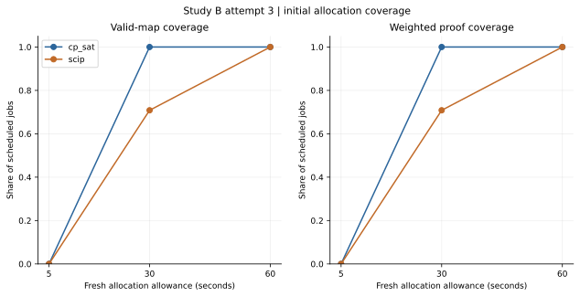
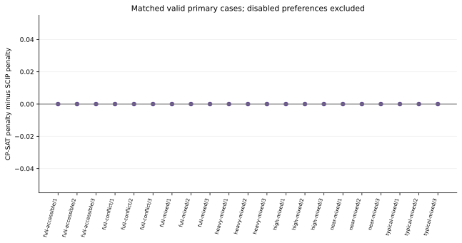
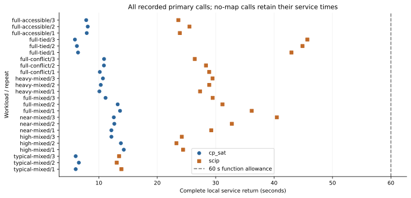
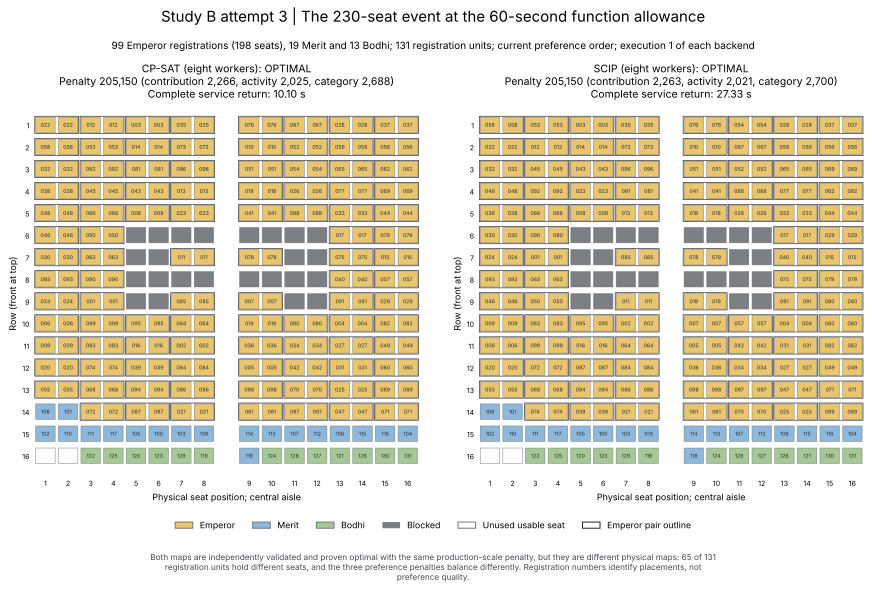
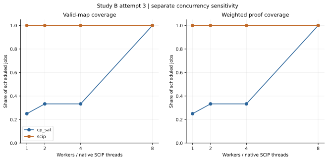
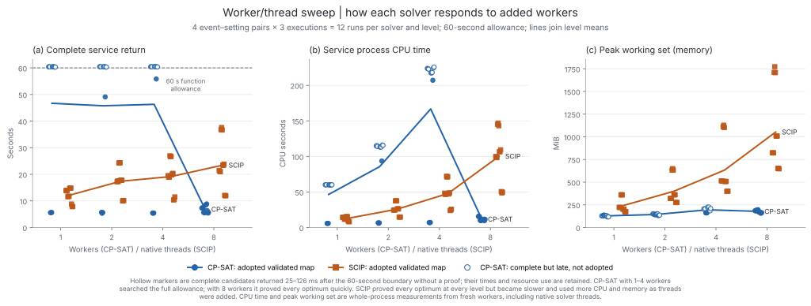
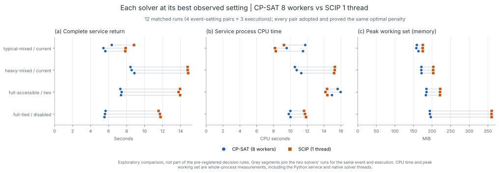

# Chapter 4: Results and Discussion

*Draft, 24 October 2026. All values are taken from saved run records, including the worker/thread sweep, whose design and interpretation rules were fixed in advance ([pre-registration][sweep-prereg]). No solver was rerun for this chapter.*

## 4.1 Introduction

This chapter evaluates the seating allocation engine developed for Objective 1, which models PJKIT seat allocation as a constraint optimization problem with compulsory seating rules and weighted, configurable preferences. The evaluation was designed to select the solver that the system should use for initial seating-plan generation, and to provide experimental evidence for that choice rather than presume it.

Two claims are tested. The primary claim is that, **in the configuration the system actually runs (eight parallel workers and a 60-second allowance), CP-SAT is the best of the exact solvers tested on PJKIT-scale events**. The supporting claim is that **exact optimization is preferable to heuristic construction for this problem**. The primary claim rests on a production benchmark (Study B) comparing CP-SAT with the SCIP mixed-integer programming solver through the system's own allocation service. The supporting claim rests on an earlier controlled screening study (Study A), which also tested a constraint-aware greedy constructor. A worker/thread sweep (Section 4.5) then tests whether the solver ranking depends on the degree of parallelism, which is the main difference between the two studies.

Section 4.2 sets out the evaluation measures and design. Section 4.3 summarizes the Study A screening, Section 4.4 presents the Study B comparison and Section 4.5 the sweep. Section 4.6 discusses the findings, Section 4.7 addresses threats to validity and Section 4.8 summarizes the chapter. Supplementary Study A results are given in Appendix C.

## 4.2 Evaluation design

### 4.2.1 Selection measures

The solver comparison uses the measures in Table 4.1, which were fixed in a ranking order before Study B was executed. Validity is a gate that every candidate solver must pass; the remaining measures rank the solvers in order, and a later measure is consulted only when every earlier one ties. Consistency is reported as supporting evidence and is not a ranking step, because adding it after the results were known would change the test retrospectively.

*Table 4.1. Solver selection measures in their registered order.*

| Order | Measure | Definition | Role |
| ---: | --- | --- | --- |
| Gate | Validity | Every adopted allocation is a validated seating allocation: complete, with every compulsory rule passing independent checking | Must be met; zero invalid adopted maps |
| 1 | Coverage | Share of scheduled runs that return an adopted validated allocation within the allowance | First ranking measure |
| 2 | Cost | Weighted preference penalty, compared within the same event and setting on runs where both solvers returned a map | Second ranking measure |
| 3 | Proof | Share of runs whose penalty is proven to be the minimum of the declared objective | Third ranking measure |
| 4 | Time | Complete service return: time from requesting an allocation until the full validated and saved response is returned | Fourth ranking measure |
| — | Consistency | The same coverage outcome and proven penalty across repeated and input-reordered runs, plus the spread of complete service return | Supporting evidence only |

Three distinctions are important for interpretation. First, every input in these experiments is known to be feasible, so a run that returns no map, or returns one too late, is a coverage miss rather than evidence that the request is infeasible. Second, an `OPTIMAL` result means the solver proved that no lower penalty exists; a `FEASIBLE` result is a valid map without that proof. Third, complete service return is the time staff wait; it is not the moment at which an optimal plan was first found, which neither study recorded.

### 4.2.2 Events, preference settings and cohorts

All events are synthetic and known to be feasible, use the PJKIT layout of 232 usable seats, and count registrations as allocation units: an Emperor registration requires an approved two-seat pair, whereas a Merit or Bodhi registration requires one seat. Four preference settings were used: *current* (contribution > activity > category), *reversed* (category > activity > contribution), *two preferences* (contribution > category, activity disabled) and *disabled* (all preferences off). The disabled setting retains every compulsory rule; its penalty is zero by construction, so it tests coverage, proof and time but carries no information about preference quality. Penalties are compared only within the same event and setting.

Study B used eight event–setting pairs drawn from the Study A inputs with unchanged file hashes (Table 4.2). They span moderate to full occupancy and include the Emperor-heavy case and one conflict, tied and accessibility scenario, so every preference setting is represented.

*Table 4.2. Study B event–setting pairs.*

| Event / setting | Registration units | Physical seats used / 232 |
| --- | ---: | ---: |
| `typical-mixed/current` | 96 | 152 |
| `high-mixed/current` | 117 | 179 |
| `near-mixed/current` | 139 | 212 |
| `full-mixed/current` | 152 | 232 |
| `heavy-mixed/current` (99 Emperor, 19 Merit, 13 Bodhi) | 131 | 230 |
| `full-conflict/reversed` | 152 | 232 |
| `full-tied/disabled` (control) | 152 | 232 |
| `full-accessible/two` | 152 | 232 |

Table 4.3 lists the cohorts. They are analysed separately and never pooled into a single success rate.

*Table 4.3. Experimental cohorts.*

| Study | Cohort | Design | Jobs | Purpose |
| --- | --- | --- | ---: | --- |
| A | Screening | 21 events × 4 settings × 3 methods (CP-SAT, SCIP, greedy); one worker; 5-s search allowance, plus 30/60 s on 12 large-event cases | 324 | Exact optimization versus heuristic construction |
| B | Primary | 8 pairs × 3 executions × 2 solvers; eight workers; 60-s allowance | 48 | Solver selection |
| B | Diagnostic | As primary, at 5-s and 30-s allowances | 96 | Sensitivity to the allowance |
| Sweep | Worker/thread sensitivity | 4 pairs × 3 executions × 2 solvers × 1/2/4/8 workers; 60-s allowance | 96 | Effect of parallelism on the ranking |

In Study B and the sweep, executions 1 and 2 use the original input order and execution 3 a semantics-preserving permutation. Both solvers use eight workers in the Study B cohorts (native concurrent solvers for SCIP, verified from the solver logs), the same search seed, and no canonical tie-breaking stage. The allowance is a shared function allowance that starts at the service boundary and must cover data normalization, model building and search; a candidate that is complete but returns after the allowance is not adopted. Study A's allowance, by contrast, applied to solver search alone, after model building. Both studies ran on the same Windows 11 workstation (6 physical / 12 logical cores, Python 3.14.7, OR-Tools 9.15.6755, SCIP 10.0.0 with SoPlex 8.0.0).

## 4.3 Study A screening: exact optimization versus heuristic construction

Study A compared CP-SAT, SCIP and a deterministic constraint-aware greedy constructor under a common single-worker configuration. All 324 controlled trials completed and no invalid allocation was returned. Its role in this chapter is limited to the supporting claim and to motivating the production benchmark; its full results are given in Appendix C.

Figure 4.1 shows the outcome of every five-second trial. Across the 63 cases with active preferences, CP-SAT returned 50 validated maps (79.4%), SCIP 26 (41.3%) and the greedy constructor 13 (20.6%). The greedy constructor returned no map in any of the 21 disabled-preference cases, so removing preference optimization did not resolve its difficulty with the compulsory rules. On the 12 large-event cases tested at longer allowances, its coverage stayed at 2 of 12 at 5, 30 and 60 seconds, because it stops at an irreversible dead end rather than continuing to search, whereas both exact solvers reached 12 of 12 by 30 seconds.

*Figure 4.1. Study A five-second outcomes for 21 events × 4 settings × 3 methods (one worker). O = validated optimal, F = validated feasible, U = no validated map, C = greedy construction failure; no invalid output or incomplete execution occurred. Source: [Study A run records][a-runs].*

Figure 4.2 compares penalties where both methods returned a map. CP-SAT had a lower penalty than greedy in all 11 such pairs, with median differences of −22.21, −13.10 and −16.94 penalty units per registration under the current, reversed and two-preference settings. Greedy was faster in each of these pairs, so its speed advantage is real but comes with substantially worse preference quality and low coverage. Together these results support the claim that exact optimization is preferable to heuristic construction for this problem, and they justify excluding the implemented greedy constructor from the production comparison.

*Figure 4.2. `(CP-SAT penalty − comparator penalty) / registration units`, on cases where both methods returned validated maps. Negative values favour CP-SAT. Source: [paired-cost table][a-paired-table].*

Study A did not settle the choice between the two exact solvers. With one worker, CP-SAT returned more maps at five seconds, but SCIP never had a higher penalty in the 26 both-valid pairs and, on the 12 large-event cases at 30 and 60 seconds, proved all 12 optima in about 8–15 seconds, whereas CP-SAT proved none and used the full allowance. However, four separate checks of the system's production path, which ran CP-SAT with eight workers, proved the same optima that single-worker CP-SAT had not. A single-worker comparison therefore could not determine which solver performs best in the configuration the system actually uses, and Study B was designed to answer that question directly.

## 4.4 Study B: production solver comparison

### 4.4.1 Execution integrity

All 144 scheduled Study B jobs completed. Before measurement, a preflight stage confirmed that both solvers returned correct results on 72 small test cases with known answers, including deliberately infeasible ones, that SCIP launched eight concurrent solvers, and that the service adopted valid candidates and rejected invalid ones. After measurement, all 99 returned candidates were independently re-validated and rescored, no invalid map was adopted, and all record checksums were verified. The run is attempt 3: attempt 2 stopped after 125 of 144 jobs because Windows denied a file replacement while saving evidence, and attempt 3 repeated the unchanged design with only the file-saving step repaired. No records from earlier attempts are included. Sources: [manifest][b-manifest], [audit][b-checks] and [run records][b-runs].

### 4.4.2 Validity and coverage

Figure 4.3 and Table 4.4 show coverage at each allowance. At the primary 60-second allowance both solvers adopted validated maps in all 24 runs, and both passed the validity gate. **Coverage therefore ties.**

*Figure 4.3. Share of 24 runs per solver with an adopted validated map (left) and with a proven optimum (right). The panels coincide because every adopted map was proven. Each allowance is an independent set of fresh runs. Source: [coverage table][b-coverage].*

*Table 4.4. Study B outcomes by allowance (24 runs per solver at each allowance).*

| Allowance | Solver | Adopted valid maps | Proven optimal | Late candidate | No map | Invalid |
| ---: | --- | ---: | ---: | ---: | ---: | ---: |
| 5 s | CP-SAT | 0 | 0 | 3 | 21 | 0 |
| 5 s | SCIP | 0 | 0 | 0 | 24 | 0 |
| 30 s | CP-SAT | 24 | 24 | 0 | 0 | 0 |
| 30 s | SCIP | 17 | 17 | 7 | 0 | 0 |
| **60 s** | **CP-SAT** | **24** | **24** | 0 | 0 | 0 |
| **60 s** | **SCIP** | **24** | **24** | 0 | 0 | 0 |

The shorter allowances are diagnostic. At five seconds, data normalization and model building alone took at least five seconds in 14 of 24 CP-SAT runs and 15 of 24 SCIP runs, so neither solver usually had any search time; the only complete candidates were three CP-SAT results that arrived 37–76 milliseconds late. This reflects the service clock and model-building time, not the solvers' search ability. At 30 seconds, CP-SAT adopted all 24 maps, whereas seven SCIP maps were valid and proven but arrived between 30.07 and 38.53 seconds and were therefore not adopted.

### 4.4.3 Cost and proof

Both solvers proved the optimum in all 24 primary runs, so **proof coverage ties**. Figure 4.4 shows that the penalty difference between CP-SAT and SCIP was exactly zero in all 21 runs with active preferences, so **cost also ties**. The three disabled-control runs are excluded from this comparison because their penalty is zero by construction.

*Figure 4.4. CP-SAT penalty minus SCIP penalty for the 21 active-preference runs at 60 seconds (seven pairs × three executions). Every difference is zero. Source: [matched objectives][b-paired].*

Table 4.5 lists the proven optima and compares them with Study A. The production service uses preference coefficients exactly ten times those of Study A in every setting (for example 40 : 30 : 20 rather than 4 : 3 : 2), which leaves the optimal allocation unchanged. Dividing each Study B optimum by ten therefore places it on the Study A scale.

*Table 4.5. Proven Study B optima (identical for both solvers and all three executions) compared with Study A.*

| Event / setting | Study B optimum | ÷ 10 | Best Study A result | Agreement |
| --- | ---: | ---: | --- | --- |
| `typical-mixed/current` | 154,960 | 15,496 | SCIP optimal 15,496 | Identical |
| `high-mixed/current` | 190,930 | 19,093 | SCIP optimal 19,093 | Identical |
| `near-mixed/current` | 231,940 | 23,194 | SCIP optimal 23,194 | Identical |
| `full-mixed/current` | 249,590 | 24,959 | SCIP optimal 24,959 | Identical |
| `heavy-mixed/current` | 205,150 | 20,515 | SCIP optimal 20,515 | Identical |
| `full-conflict/reversed` | 299,120 | 29,912 | CP-SAT feasible 34,870 (5 s) | Study A value 16.6% above the optimum |
| `full-accessible/two` | 178,870 | 17,887 | CP-SAT feasible 20,815 (5 s) | Study A value 16.4% above the optimum |
| `full-tied/disabled` | 0 | 0 | CP-SAT optimal 0 | Control |

For all five events on which Study A also proved an optimum, the values agree exactly. Two independently implemented test harnesses, two solvers and two coefficient scales therefore reach the same optimum, which is strong evidence that the production service encodes the same allocation problem as the Study A model. For the conflict and accessibility cases, Study B provides the first proven optima. The unproved five-second maps from Study A were about 16% worse on the common scale, which shows the practical cost of returning an unproved map.

### 4.4.4 Time

With validity, coverage, cost and proof all tied, the ranking is decided by complete service return. Figure 4.5 shows every primary run and Table 4.6 summarizes the decision measures.

*Figure 4.5. Complete service return for each primary run, grouped by event and execution (execution 3 uses the permuted input). Circles show CP-SAT and squares SCIP. Every run returned before the 60-second allowance (dashed line). Source: [run records][b-runs].*

*Table 4.6. Study B primary decision measures at 60 seconds (24 runs per solver).*

| Measure | CP-SAT | SCIP | Result |
| --- | ---: | ---: | --- |
| Validity: invalid adopted maps | 0 | 0 | Both pass |
| 1. Coverage | 24/24 | 24/24 | Tie |
| 2. Cost: active-preference pairs with equal penalty | 21/21 | 21/21 | Tie |
| 3. Proof | 24/24 | 24/24 | Tie |
| 4. Time: complete service return, mean | 9.99 s | 28.65 s | CP-SAT shorter |
| 4. Time: complete service return, median | 10.52 s | 28.62 s | CP-SAT shorter |
| 4. Time: complete service return, range | 5.91–14.27 s | 13.06–45.69 s | CP-SAT shorter in 24 of 24 pairs |

CP-SAT returned sooner in every one of the 24 matched pairs. The SCIP-minus-CP-SAT difference had a median of 17.44 seconds (range 6.48–39.79 seconds), and SCIP took a median of 2.65 times as long. Table 4.7 shows that the result holds for every event and preference setting, with no overlap between the two solvers' times for any pair.

*Table 4.7. Mean complete service return by event–setting pair (three runs per solver).*

| Event / setting | CP-SAT (s) | SCIP (s) | Ratio SCIP / CP-SAT |
| --- | ---: | ---: | ---: |
| `typical-mixed/current` | 6.22 | 13.46 | 2.17 |
| `high-mixed/current` | 13.40 | 23.97 | 1.80 |
| `near-mixed/current` | 12.45 | 34.16 | 2.74 |
| `full-mixed/current` | 12.67 | 32.27 | 2.55 |
| `heavy-mixed/current` | 10.38 | 28.57 | 2.75 |
| `full-conflict/reversed` | 10.64 | 27.88 | 2.63 |
| `full-accessible/two` | 7.96 | 24.33 | 3.06 |
| `full-tied/disabled` | 6.20 | 44.51 | 7.20 |

The recorded phases show where the difference arises. Model building took the same time for both solvers (mean 5.37 seconds for CP-SAT and 5.36 for SCIP), whereas the search phase averaged 2.98 seconds for CP-SAT and 21.05 seconds for SCIP. Search therefore accounts for 18.08 of the 18.66-second mean gap (96.9%). The comparison is between the solvers' search and proof speed on a common model-building pipeline. For CP-SAT, model building is the largest component of the response time (53.7% of the mean), with search at 29.8%. Validation, formatting and saving after the search added about 1.5 seconds for CP-SAT and 2.1 seconds for SCIP. Source: [phase timing][b-phase].

### 4.4.5 Consistency (supporting evidence)

Both solvers were consistent in outcome. Each returned the same coverage result and the same proven penalty in all three executions of every pair, including the execution with the permuted input. Timing variation between executions was similar in relative terms: the median coefficient of variation within a pair was 4.1% for CP-SAT and 4.1% for SCIP. In absolute terms SCIP varied more, with a median within-pair range of 2.30 seconds against CP-SAT's 0.57 seconds and a maximum of 11.23 seconds (`near-mixed/current`) against 2.48 seconds. The permuted input did not change the direction of the result: CP-SAT averaged 10.16 seconds on original-order runs and 9.66 on permuted runs, against 28.42 and 29.10 seconds for SCIP.

Equal proven penalties do not mean identical seating plans. Figure 4.6 shows the first-run maps of both solvers for the Emperor-heavy case. Both are validated and optimal with a penalty of 205,150, but 65 of 131 registration units hold different seats, and the three preference penalties balance differently (contribution 2,266, activity 2,025 and category 2,688 for CP-SAT, against 2,263, 2,021 and 2,700 for SCIP). The compulsory rules and weights admit several optimal plans, so a guarantee of an identical plan for an identical request must come from the application's stored result rather than from the solver. That behaviour was outside the scope of this benchmark.

*Figure 4.6. `heavy-mixed/current`, execution 1 of each solver, eight workers and a 60-second allowance. Yellow = Emperor (outlined pairs), blue = Merit, green = Bodhi, grey = blocked and white = unused usable seat. Both maps are validated and proven optimal at the same penalty but differ in the seats held by 65 of 131 registration units. Rendered from saved records only; source hashes in the [figure manifest][b-map-manifest].*

The solvers also differed in resource use. Across the primary runs, mean process CPU time was 19.7 seconds for CP-SAT and 119.7 seconds for SCIP, and mean peak memory was 188 MiB and 996 MiB respectively. These are descriptive observations rather than ranking measures, but they are relevant to deployment, where memory allocation affects cost and the number of requests that can be served at once.

### 4.4.6 Selection outcome

Under the registered order, CP-SAT and SCIP tie on validity, coverage, cost and proof, and CP-SAT ranks first on time, returning sooner in all 24 matched runs. **CP-SAT is therefore selected as the initial-generation solver for the tested configuration.** The diagnostic, consistency and resource results all point in the same direction, although the selection does not depend on them.

## 4.5 Worker/thread sensitivity

The sweep holds the production service, the four event–setting pairs (`typical-mixed/current`, `heavy-mixed/current`, `full-tied/disabled`, `full-accessible/two`), the 60-second allowance and the seeds fixed, and varies only the number of workers (1, 2, 4 or 8; native threads for SCIP). The registered measures in Table 4.1 are applied separately at each worker level over 12 matched runs. On cost and time, a solver ranks first if it is better in more than half of the runs in which both returned a map. The interpretation was fixed before the sweep ran: SCIP ranking first at one worker and CP-SAT at eight indicates a configuration-dependent ranking (Scenario 1); CP-SAT ranking first at every level indicates that parallelism does not explain Study A (Scenario 2); and SCIP ranking first at eight workers, or neither solver doing so, would mean the Study B result was not reproduced (Scenario 3). Any other pattern would be reported case by case (Scenario 4).

All 96 jobs completed in 53.7 minutes. They ran from committed code, and all 96 candidates were independently rescored with no invalid adopted map. Sources: [sweep audit][s-checks], [run records][s-runs] and [manifest][s-manifest].

*Figure 4.7. Share of 12 runs per solver and worker level with an adopted validated map (left) and a proven optimum (right), at a 60-second allowance. SCIP covers every run at every level. CP-SAT covers 3, 4, 4 and 12 of 12 runs at 1, 2, 4 and 8 workers. Source: [sweep coverage][s-coverage].*

*Table 4.8. Registered measures at each worker level (12 matched runs per solver).*

| Workers | CP-SAT adopted / proven | SCIP adopted / proven | Mean complete service return, CP-SAT / SCIP (s) | First separating measure | Ranks first |
| ---: | ---: | ---: | ---: | --- | --- |
| 1 | 3 / 3 | 12 / 12 | 46.69 / 12.14 | Coverage | SCIP |
| 2 | 4 / 4 | 12 / 12 | 45.76 / 17.37 | Coverage | SCIP |
| 4 | 4 / 4 | 12 / 12 | 46.30 / 19.19 | Coverage | SCIP |
| 8 | 12 / 12 | 12 / 12 | 6.85 / 23.43 | Time (CP-SAT shorter in 12 of 12; median 14.46 s) | CP-SAT |

With one, two or four workers, CP-SAT adopted only 3, 4 and 4 maps. Its other runs (9, 8 and 8) produced complete, valid candidates, but these were unproven and returned 25–126 milliseconds after the 60-second boundary, because CP-SAT spent the entire allowance searching without completing a proof. Under the registered rules these are coverage misses. The ranking does not depend on that strictness. If those late candidates were accepted, SCIP would still rank first at one worker on cost (CP-SAT's one-worker penalties were 4.95% and 18.34% above the optimum on `heavy-mixed` and `full-accessible`). At two and four workers, SCIP would still rank first on proof. SCIP adopted and proved every map at every level, but it became slower as threads were added, with mean times of 12.14, 17.37, 19.19 and 23.43 seconds and mean CPU time rising from 12.5 to 100.3 seconds. At eight workers both solvers covered and proved all 12 runs with identical penalties, and CP-SAT was faster in every pair, which reproduces the Study B result. **SCIP ranks first at one worker and CP-SAT at eight, so the pre-registered reading is Scenario 1: the solver ranking depends on the parallel configuration.**

Figure 4.8 shows every run's time, CPU and memory use, so that the two solvers' opposite responses to added workers are visible run by run.

*Figure 4.8. Every sweep run (12 per solver and level), with lines joining level means. Filled markers are adopted validated maps. Hollow markers are complete CP-SAT candidates that returned after the 60-second boundary and were not adopted; they remain in the figure so that no run disappears. With one to four workers, CP-SAT ran to the time limit. Its CPU time grew with the number of workers searching (mean 46, 86 and 167 CPU seconds), while its only fast runs were the disabled-preference control and one `typical-mixed` run. At eight workers it returned in 5.4–8.9 seconds. SCIP's time, CPU and memory all rose with each added thread (mean peak memory 240, 399, 634 and 1,053 MiB). Source: [sweep run records][s-runs] and [level summary][sf-levels].*

The native solver logs, examined after the result was known, show why. Table 4.9 groups the 48 CP-SAT runs by the search strategies that CP-SAT's default configuration launched.

*Table 4.9. CP-SAT proof outcome by whether its strategy set included a strong linear-relaxation strategy (`max_lp`, `max_lp_sym` or `reduced_costs`). Source: native CP-SAT logs in the sweep folder.*

| Strategy set | Runs | Proved optimal | Of which active-preference runs proved |
| --- | ---: | ---: | --- |
| Includes a strong linear-relaxation strategy (all 8-worker runs; `full-tied` at 4 workers) | 15 | 15 | 9 of 9 |
| Does not include one (all 1- and 2-worker runs; other 4-worker runs) | 33 | 8 | 2 of 27 |

At eight workers, the first strategy to finish in every run was `max_lp`, `max_lp_sym` or `reduced_costs`, which closed the gap between the best plan and the proven lower bound within 1.1–3.0 seconds of solver time. For example, on `heavy-mixed` it raised the lower bound to the optimum of 205,150 at 1.22 seconds. With four workers, CP-SAT's default set (core, default_lp and no_lp) left the lower bound at 185,700 for the whole run, while its local-search strategies improved the plan to within 0.04–0.13% of the optimum without being able to prove it. SCIP, which is built on linear-programming relaxations, solved all 12 one-thread runs at the first node of its search tree. The model's linear relaxation is therefore strong enough to prove the optimum almost immediately. What separates the configurations is whether the solver applies that relaxation: SCIP always does, whereas CP-SAT's default configuration includes its strongest linear-relaxation strategies only when it has eight workers.

The sweep also allows each solver to be compared at its own best observed setting: CP-SAT with eight workers, its default parallel design, and SCIP with one thread, at which it was fastest. This comparison was not part of the pre-registered rules and is reported as exploratory, but it addresses the concern that the Study B result reflects a configuration unfavourable to SCIP. Figure 4.9 and Table 4.10 compare time, CPU and memory on the 12 matched runs, every one of which adopted and proved the same optimal penalty for both solvers.

*Figure 4.9. Complete service return, process CPU time and peak memory for each matched run, grouped by event–setting pair; grey segments join the two solvers' runs for the same event and execution. Source: [best-setting pairs][sf-best].*

*Table 4.10. Each solver at its best observed setting (12 matched runs, identical proven penalties).*

| Measure | CP-SAT, 8 workers: mean (range) | SCIP, 1 thread: mean (range) | CP-SAT lower in | Median difference (SCIP − CP-SAT) |
| --- | ---: | ---: | ---: | ---: |
| Complete service return (s) | 6.85 (5.43–8.87) | 12.14 (7.86–14.84) | 12 of 12 | 6.17 s |
| Process CPU time (s) | 11.81 (9.56–15.97) | 12.46 (8.17–15.28) | 6 of 12 | 0.54 s |
| Peak working set (MiB) | 177.7 (157.7–196.6) | 239.9 (174.7–360.4) | 12 of 12 | 34.2 MiB |
| CPU seconds per second of response | 1.72 | 1.03 | — | — |

CP-SAT returned sooner in every run and used less memory in every run. Total CPU time, however, was effectively equal: each solver used less in six of the 12 runs, with CP-SAT lower on `heavy-mixed` and `full-tied` and SCIP lower on `typical-mixed` and `full-accessible`. The two solvers therefore consume a similar amount of computation per allocation, but CP-SAT spreads it across several cores for a short time, using about 1.7 cores on average over the response, whereas SCIP uses one core for longer. For a single request, this converts the same computing cost into a response that is about six seconds faster. Under heavy concurrent load, where total CPU time determines capacity, the two would be similar, and that condition was not tested. The memory difference was largest on the disabled-preference control (about 195 against 360 MiB).

## 4.6 Discussion

### 4.6.1 What the evidence supports

The primary claim is supported. In the configuration the system runs, both exact solvers satisfied every requirement equally: no invalid maps, complete coverage, identical proven penalties and complete proof. CP-SAT was faster in every matched run, at a median of 10.5 seconds against 28.6 seconds, and, with both solvers on eight workers, used about one sixth of the CPU time and one fifth of the memory. Against SCIP at its own best setting of one thread, CP-SAT remained faster in every run and used less memory, with total CPU time about equal (Table 4.10). The result held across all eight event–setting pairs, all four preference settings, and the original and permuted input orders. The choice of CP-SAT therefore rests on a measured advantage on the only criterion that separated the solvers, not on prior preference for the solver used in the prototype.

The supporting claim is also supported. The implemented greedy constructor returned maps for about one in five active-preference cases, none of the disabled-preference cases, and no additional cases when given more time. Where it did return a map, its penalty was higher than CP-SAT's in every case. Its speed does not compensate for these shortcomings when the system must reliably produce a complete, rule-compliant plan. This is consistent with the motivation for constraint modelling in the literature review: in a tightly packed hall, Emperor pairing, tier ordering and front-to-back packing interact, so early placement decisions that cannot be revised easily lead to dead ends (Rossi et al., 2006; Schiex et al., 1995). The conclusion applies to the implemented constructor; a heuristic with backtracking or repair might perform differently.

The answers to the three questions of cost, accuracy and time are therefore as follows. Validity is guaranteed for both exact solvers by independent checking, so it is a requirement rather than a differentiator. At the 60-second allowance, cost is identical because both solvers prove the same optimum. Time is the decisive difference, and it favours CP-SAT.

### 4.6.2 Why the solver ranking differs between Study A and Study B

With one worker in Study A, SCIP proved optima quickly while CP-SAT did not. With eight workers in Study B, both proved every optimum and CP-SAT was faster. Because the two studies also differ in their clocks, model-building code paths and case selection, this difference could not be explained from their data alone. The worker sweep removes those differences and reproduces both results within one harness. At one worker, SCIP returned proven optima in 7.9–14.8 seconds while CP-SAT used the whole allowance without proof, closely matching Study A's 8.4–14.7 seconds for SCIP. At eight workers, CP-SAT was faster in every run, matching Study B. Study A and Study B are therefore not in conflict: each correctly measured a different configuration, and the sweep shows the ranking changing between four and eight workers (Scenario 1).

The logs explain the change. CP-SAT is a portfolio solver that runs different search strategies in parallel workers which share solutions and bounds (Perron & Didier, 2023; Stuckey, 2010). The strategies it launches depend on the number of workers, and its strongest linear-relaxation strategies are included only at eight. On this model the linear relaxation is strong enough to prove the optimum at once, which is also why SCIP, a branch-and-bound solver built on linear-programming relaxations (Williams, 2013), solves these problems at its first node even with one thread. With eight workers, CP-SAT combines that relaxation with its other strategies and proves the optimum in one to three seconds of solver time. Additional SCIP threads, by contrast, run concurrent copies of the solve that add overhead without improving the proof, so SCIP was fastest with one thread. "More workers" is therefore not beneficial in itself: what matters is whether the configuration applies strong linear-relaxation reasoning to this model. This explanation comes from logs examined after the result was known, so it is an observed mechanism on these cases rather than a pre-registered test.

### 4.6.3 Implications for the system

The results lead to five practical conclusions. First, CP-SAT should remain the default initial-generation solver; Study A's single-worker results do not justify a change to SCIP. Second, the eight-worker setting is part of that choice rather than an incidental detail. With four or fewer workers, CP-SAT's default configuration failed to prove most optima within 60 seconds, so the deployment environment must provide eight workers, or CP-SAT must be configured explicitly to apply its strong linear-relaxation strategy. The latter option is untested and is left for future work. Third, a five-second allowance is not viable in the current pipeline, because model building alone takes about five seconds on the larger events. If staff later require faster responses, model building, at more than half of CP-SAT's response time, is the most promising part of the pipeline to optimize. Fourth, because several plans can share the optimal penalty (Figure 4.6), returning the same plan for the same request should be handled by the application's stored results rather than by a solver tie-breaking stage. Earlier production checks suggest that such a stage can lengthen a roughly ten-second result to more than 60 seconds without improving the penalty. Fifth, CP-SAT's resource profile suits the planned serverless deployment. It used less memory than SCIP at every tested setting, and its total CPU time was about the same as single-thread SCIP's. Its eight workers, however, require several cores for a few seconds per request, so the function's CPU allocation must allow this. Neither property was measured in the deployment environment.

Against the Objective 1 success criterion in the interim report, the evidence is supportive but not complete. All Study B events, from 96 to 152 registration units and up to full occupancy, were solved to proven optimality within the 60-second allowance, with complete service returns of at most 14.3 seconds for CP-SAT. However, the criterion specified a default 122-participant scenario, which was not tested directly, and comparison with random and first-come-first-served baselines, which were not executed; only the greedy baseline was evaluated.

The findings are consistent with Ipsen et al. (2026), who applied exact integer programming to seating allocation in large organizations. Exact methods are computationally practical for a single hall of PJKIT's size, provided that the solver configuration is chosen with care.

## 4.7 Threats to validity

The penalty measures agreement with the encoded preference model under assumed weights. It has not been validated against attendee or staff satisfaction, so an optimal result is optimal only for the declared objective (**construct validity**). Within each study the comparison is controlled: both solvers received identical inputs, rules and weights, and every map was checked independently. Between studies, parallelism, clocks and code paths all differ at once. The sweep addressed this by reproducing both studies' rankings within a single harness. Its mechanistic explanation, however, rests on logs examined after the result was known (**internal validity**). Study B was run with uncommitted changes to the benchmark code. The exact code used is preserved in the study's source snapshot and its file hashes were verified as unchanged during the run, but reproduction requires that snapshot rather than the recorded git revision alone. The sweep's manifest records revision `f46f021` with no modified tracked files, so the sweep ran from committed benchmark code. Its pre-registration document was written at 01:01 local time, before the sweep started at 01:22. It was committed only while the sweep was running, before any sweep result was inspected, and its SHA-256 (`84f2358f…52d60`) is identical to the version that existed before the sweep began.

All inputs are synthetic and known to be feasible, share one 232-seat layout, and were run on one workstation. Study B covered eight event–setting pairs. The results do not establish performance on real assemblies, infeasible requests, other hardware, the planned cloud deployment or concurrent requests (**external validity**). Three executions per case describe observed variation but do not estimate reliability across future events or worst-case response times, and no inferential statistics are claimed (**statistical conclusion validity**). Finally, the benchmark did not test regeneration after preference changes, absence-driven reallocation under Objective 2, or the application's stored-result behaviour. These require separate evaluation.

## 4.8 Summary

This chapter tested two claims. The Study A screening showed that the implemented greedy constructor returned too few complete maps, and higher penalties where it did, to serve as the system's allocator, which supports the use of exact optimization. The Study B production benchmark showed that, with eight workers and a 60-second allowance, CP-SAT and SCIP both produced validated, proven-optimal maps in all 24 primary runs with identical penalties, and that CP-SAT returned the complete response sooner in all 24 matched runs, at a median of 10.5 seconds against 28.6 seconds. CP-SAT is therefore selected as the initial-generation solver for the configuration the system runs. The production optima matched Study A's independently proven optima exactly, which supports the correctness of the encoding.

The worker/thread sweep connected the two studies. Within one harness it reproduced Study A's single-worker advantage for SCIP and Study B's eight-worker advantage for CP-SAT, with the ranking changing between four and eight workers. The solver logs attribute this change to CP-SAT launching its strong linear-relaxation strategies only at eight workers. CP-SAT with eight workers was also faster than SCIP at its own best setting of one thread in all 12 matched runs, with less memory and about the same total CPU time.

The selection is conditional on the tested configuration and synthetic events. It is not a claim that CP-SAT is universally faster, nor a guarantee that every future event will be proven optimal within 60 seconds.

## References cited in this chapter

Ipsen, A., Cashmore, M., Fielding, K., Marchesotti, N., Zehtabi, P., Magazzeni, D., & Veloso, M. (2026). *Beyond manual planning: Seating allocation for large organizations*. arXiv:2602.05875. https://arxiv.org/abs/2602.05875

Perron, L., & Didier, F. (2023). The CP-SAT-LP solver (invited talk). In *Proceedings of the 29th International Conference on Principles and Practice of Constraint Programming (CP 2023)* (Article 3). Schloss Dagstuhl – Leibniz-Zentrum für Informatik. https://doi.org/10.4230/LIPIcs.CP.2023.3

Rossi, F., van Beek, P., & Walsh, T. (Eds.). (2006). *Handbook of constraint programming*. Elsevier.

Schiex, T., Fargier, H., & Verfaillie, G. (1995). Valued constraint satisfaction problems: Hard and easy problems. In *Proceedings of the 14th International Joint Conference on Artificial Intelligence (IJCAI-95)* (pp. 631–639). Morgan Kaufmann.

Stuckey, P. J. (2010). Lazy clause generation: Combining the power of SAT and CP (and MIP?) solving. In A. Lodi, M. Milano, & P. Toth (Eds.), *Integration of AI and OR techniques in constraint programming for combinatorial optimization problems* (CPAIOR 2010, LNCS 6140, pp. 5–9). Springer. https://doi.org/10.1007/978-3-642-13520-0_3

Williams, H. P. (2013). *Model building in mathematical programming* (5th ed.). Wiley.

> *Note: merge these entries into the dissertation's consolidated APA 7 reference list, and check the descriptions of CP-SAT's portfolio search and SCIP's branch-and-bound in Section 4.6.2 against the cited sources before submission.*

---

## Appendix C: Supplementary Study A results

This appendix retains the Study A evidence that supports Section 4.3 but is not needed for the solver selection. The full Study A interpretation is preserved as a [historical source][study-a-chapter], and the [figure package][a-figures] provides PDF, SVG and PNG versions of every figure.

*Table C.1. Study A validated maps at the five-second search allowance (21 events per method and setting, one worker).*

| Setting | CP-SAT | SCIP | Greedy |
| --- | ---: | ---: | ---: |
| Current | 15 | 9 | 6 |
| Reversed | 16 | 7 | 3 |
| Two preferences | 19 | 10 | 4 |
| Disabled | 20 | 17 | 0 |

*Figure C.1. Four large mixed events × three active settings at each search allowance. Both exact solvers reached 12/12 validated maps at 30 and 60 seconds. All SCIP maps were proven optimal and all CP-SAT maps remained unproven. Greedy stayed at 2/12. Source: [matched-budget outcomes][a-matched-outcomes].*

*Figure C.2. On the same 12 cases, CP-SAT's single-worker penalty fell with more time (median −4.73 per registration from 5 to 30 s and −1.97 from 30 to 60 s) without proof, while its allocation time rose with the allowance (median 65.64 s at 60 s). SCIP proved every optimum, with a median of 10.76 s at 60 s. Source: [budget contrasts][a-budget-contrasts].*

*Figure C.3. Phase durations for the 36 single-worker 60-second runs. CP-SAT search used 60.01–60.05 s, and SCIP search 7.23–13.79 s. Source: [phase timing][a-phase-table].*

*Figure C.4. `heavy-mixed/current` with one worker: CP-SAT feasible at 21,679 (66.73 s), SCIP optimal at 20,515 (8.39 s), greedy no map. With eight workers in Study B, both solvers proved the same optimum (205,150 = 20,515 × 10; Figure 4.6). Source: [endpoint table][a-heavy-table].*

*Table C.2. Study A production-path checks (CP-SAT, eight workers, canonical tie-breaking requested, 60-second configuration). All four maps were validated and proven optimal. The canonical tie-breaking stage did not complete.*

| Event | Penalty | Service return (s) |
| --- | ---: | ---: |
| `high-mixed/current` | 19,093 | 62.55 |
| `near-mixed/current` | 23,194 | 62.51 |
| `full-mixed/current` | 24,959 | 62.60 |
| `heavy-mixed/current` | 20,515 | 62.49 |

[sweep-prereg]: ../planning/solver-selection-worker-sweep.md
[study-a-chapter]: solver-selection-v4-attempt3-results-and-discussion.md
[a-runs]: solver-selection-v4-21-events-135m-windows-main-2026-10-20-attempt3/tables/run-records.csv
[a-figures]: solver-selection-v4-attempt3-figures-2026-10-23/README.md
[a-paired-table]: solver-selection-v4-attempt3-figures-2026-10-23/tables/paired-costs.csv
[a-matched-outcomes]: solver-selection-v4-attempt3-figures-2026-10-23/tables/matched-budget-outcomes.csv
[a-budget-contrasts]: solver-selection-v4-attempt3-figures-2026-10-23/tables/budget-contrasts.csv
[a-phase-table]: solver-selection-v4-attempt3-figures-2026-10-23/tables/phase-timing-60s.csv
[a-heavy-table]: solver-selection-v4-attempt3-figures-2026-10-23/tables/230-seat-endpoints.csv
[b-manifest]: study-b-windows-2026-10-23-attempt3/manifest.json
[b-checks]: study-b-windows-2026-10-23-attempt3/checks.json
[b-runs]: study-b-windows-2026-10-23-attempt3/tables/run-records.csv
[b-coverage]: study-b-windows-2026-10-23-attempt3/tables/coverage.csv
[b-paired]: study-b-windows-2026-10-23-attempt3/tables/paired-objectives.csv
[b-phase]: study-b-windows-2026-10-23-attempt3/tables/phase-timing.csv
[b-map-manifest]: study-b-attempt3-map-figure-2026-10-24/manifest.json
[s-checks]: study-b-worker-sweep-2026-10-24/checks.json
[s-runs]: study-b-worker-sweep-2026-10-24/tables/run-records.csv
[s-manifest]: study-b-worker-sweep-2026-10-24/manifest.json
[s-coverage]: study-b-worker-sweep-2026-10-24/tables/coverage.csv
[sf-levels]: study-b-worker-sweep-figures-2026-10-24/tables/level-summary.csv
[sf-best]: study-b-worker-sweep-figures-2026-10-24/tables/best-setting-pairs.csv
