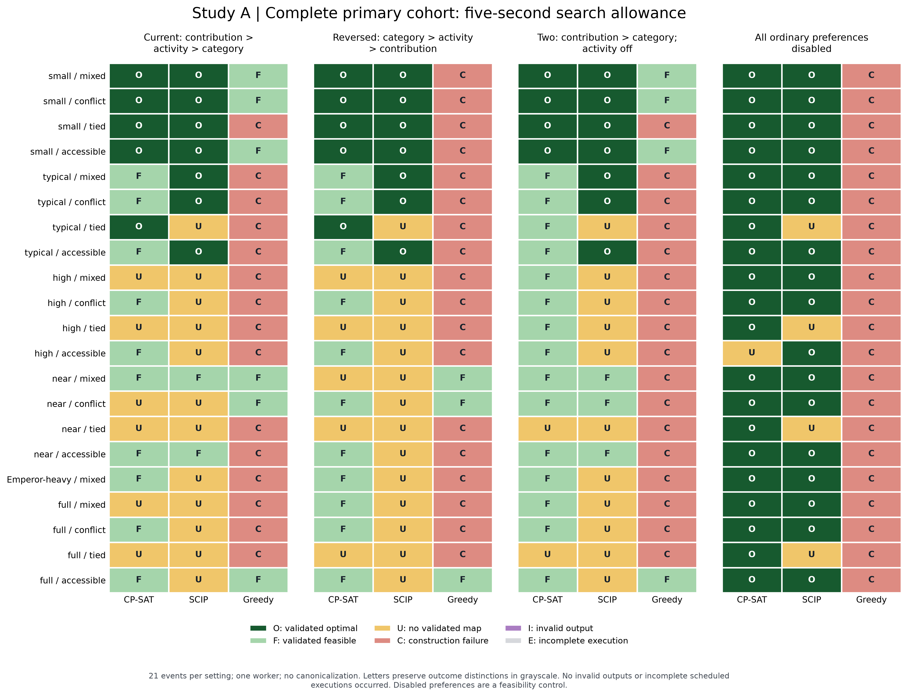
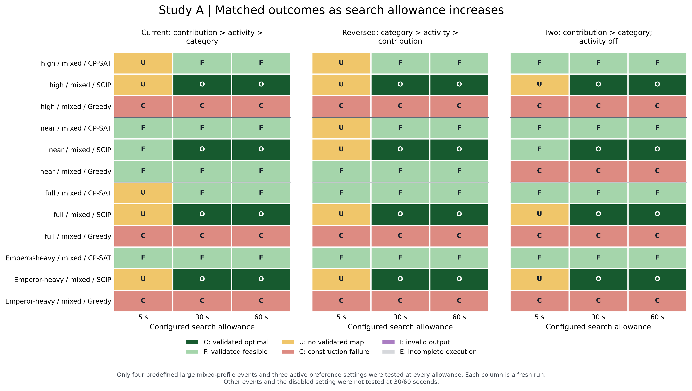
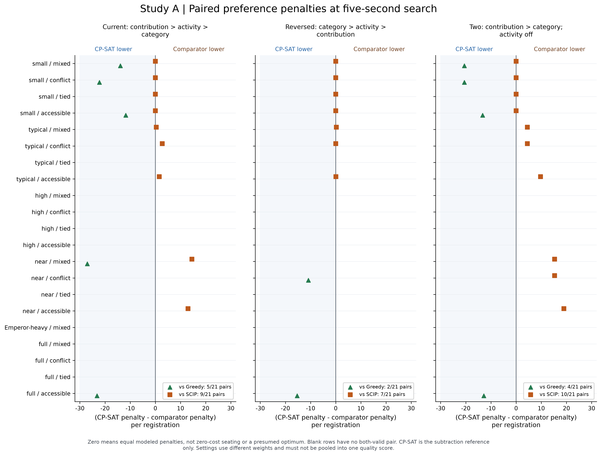
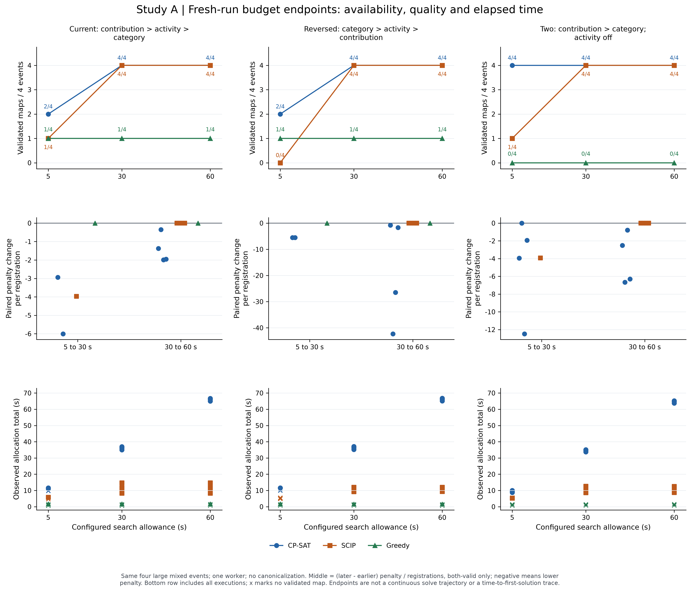
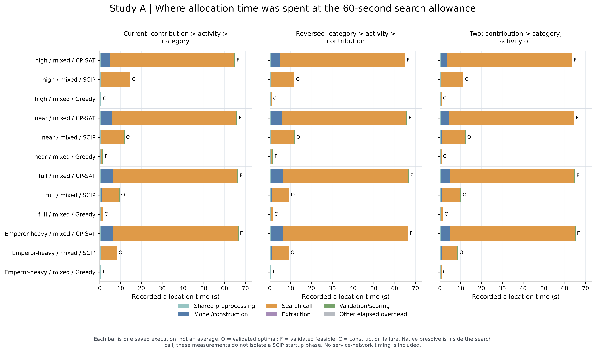
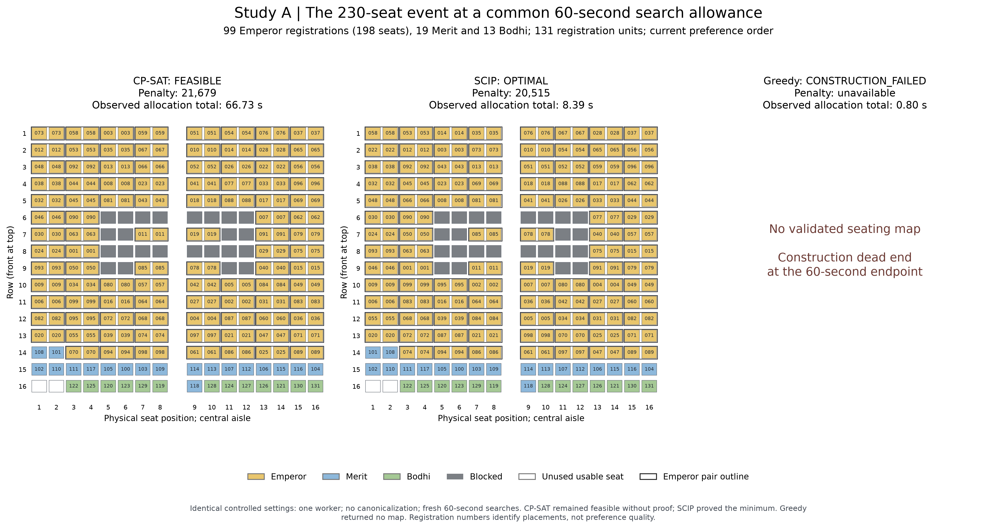

# Study A: expanded attempt 3 figure package

Presentation revision: 2026-10-23 (Asia/Kuala_Lumpur). **Saved-record postprocessing only. No solver was invoked.**

[Combined vector PDF](attempt3-figure-package.pdf) | [Checks](checks.json) | [Provenance](manifest.json)

## Separation of the two studies

- **Study A is completed evidence:** the attempt 3 Windows benchmark, with 252 primary five-second runs, 72 additional 30/60-second runs and four separate production-path checks. There were no seed repetitions. Controlled comparisons use one worker and no canonicalization.
- **Study B is a confirmed future study:** production CP-SAT versus SCIP, with verified up-to-eight-thread preference optimization, shared canonical selection and service/regeneration checks. It has not been implemented or executed. Its [figure and measurement plan](../../planning/solver-selection-production-follow-up.md) contains no result figures or invented measurements.
- Four old CP-SAT production checks are retained in the source CSV for completeness. They are not Study B results and are excluded from the controlled plots.

The original evidence directory is `/Users/dariusleeshin/.codex/worktrees/712c/FYP-Seating-Allocation/docs/results/solver-selection-v4-21-events-135m-windows-main-2026-10-20-attempt3`. It was not changed. `source-data/` copies only the saved table, heavy-event input, selected map records and original manifest needed for this package; it is not a replacement for the full original evidence bundle.

The common benchmark coefficients for (contribution, activity, category) are current **(4, 3, 2)**, reversed **(2, 3, 4)**, two **(4, 0, 3)** and disabled **(0, 0, 0)**. All methods in a setting use the same scorer. The denominator is registration units, including one registration for each two-seat Emperor pair. These are the saved benchmark's coefficients, not the production example's 40:30:20 current-order scale; the older prototype's common rescored cost must not be confused with its native service objective or timing.

## What changed

1. A1 retains all 21 events and four preference settings at five seconds, with explicit status letters and consistent colors.
2. A2 adds a matched 5/30/60-second status matrix for the four large mixed events and three active preference settings. Other long-budget cases were not tested, not failures.
3. A3 labels both directions of the paired penalty difference. Zero means equal penalties; it does not assume CP-SAT is optimal. Missing pairs remain unavailable.
4. A4 retains coverage, within-method paired penalty changes and actual allocation time, labelled as separate fresh-run endpoints. It is not a convergence or first-solution trace.
5. A5 adds the recorded phase breakdown. Native presolve remains inside search; these records do not identify a causal SCIP startup limitation.
6. A6 replaces the five-second-only main illustration with the common 60-second endpoint. It shows the saved CP-SAT FEASIBLE map, SCIP OPTIMAL map and greedy construction failure, without changing or fabricating their statuses.

## Interpretation and captions

### Coverage

The complete primary cohort contains 21 events per preference setting. The matched budget cohort contains four events per active setting, or 12 matched event-setting cases. It has CP-SAT validated counts 8/12, 12/12, 12/12; SCIP 2/12, 12/12, 12/12; and greedy 2/12 at every allowance. All 12 SCIP 30- and 60-second results are OPTIMAL; CP-SAT remains FEASIBLE on those endpoints.

No invalid returned allocations or incomplete scheduled executions occurred in the 328 saved jobs. An UNKNOWN/no-map outcome is not an invalid allocation or a proof of infeasibility. Additional unscheduled long-budget events must never be colored as failed or incomplete trials.

### Paired preference penalties

A3 uses `(CP-SAT penalty - comparator penalty) / registrations` on the same event and setting, conditional on both maps being validated. Negative favors CP-SAT; positive favors the comparator; zero is a tie. CP-SAT is an arithmetic reference, not a presumed optimum. Active pair counts are 26 against SCIP and 11 against greedy. CP-SAT lower/tied/higher counts against SCIP are 0/13/13; all 11 greedy pairs favor CP-SAT's penalty. These conditional quality comparisons do not replace availability reporting. All-disabled costs are omitted. Different setting weights must not be pooled into one quality scale.

### Search allowance and actual elapsed time

Across the same 12 cases, CP-SAT median allocation totals are approximately 10.52, 35.62 and 65.64 seconds at 5/30/60-second search allowances. SCIP medians are 5.42, 10.80 and 10.76 seconds; greedy medians are 0.88, 0.90 and 0.86 seconds. These include unsuccessful executions, with no-map markers retained in A4.

CP-SAT generally consumes its search allowance without proving the optimum on this subset. SCIP returns after proving the optimum, so 30 and 60 seconds give similar observed times. Greedy terminates on success or an irreversible construction dead end. The data support search-budget response, not a demonstrated SCIP startup delay or a continuous time-to-first-map curve. One fresh run per endpoint cannot estimate repeated-run timing variance.

### The 230-seat illustration

A6 uses the same controlled 60-second search allowance for every method. CP-SAT returned cost 21,679 in 66.729 seconds, FEASIBLE. SCIP returned cost 20,515 in 8.390 seconds, OPTIMAL. Greedy returned no map in 0.797 seconds. The selected physical allocations are checked against their saved audit and CSV, full registration coverage, entitlement, physical-seat uniqueness, blocked seats, accessibility and approved pairs.

The older eight-worker CP-SAT production check also attained common cost 20,515, but with incomplete canonicalization and different settings. It is not substituted into the controlled comparison. No saved comparable first-optimal timestamp exists. The future study must measure weighted-objective stage completion, canonical completion and complete service return separately.

### Dissertation and technical-paper use

Use A1/A2 for availability and proof outcomes, A3 for matched quality, A4 for budget response, and A6 as the main physical illustration. A5 is a supporting timing figure suitable for an appendix or for a timing-focused discussion. Keep every figure's cohort, settings and missing comparisons in its caption. These are descriptive results for related synthetic events, not human satisfaction measurements, statistical population estimates or universal solver rankings.

## Reproduce without running experiments

Requires Python, matplotlib, numpy and pypdf. The renderer imports no optimization library and does not call the service or an experiment runner.

```sh
python research/experiments/solver_selection_figures.py --source docs/results/solver-selection-v4-attempt3-figures-2026-10-23/source-data --output /tmp/pjkit-study-a-reproduced --analysis-date 2026-10-23
```

Alternatively run the identical archived renderer at `source_snapshot/solver_selection_figures.py`. Existing output directories are rejected unless `--overwrite` explicitly selects an existing package generated by this renderer. Source data cannot be overwritten. Figure exports are PDF/SVG/300-dpi PNG; the combined PDF contains the same six vector figure pages.

## Verification

328 source records; 252 primary, 72 long-budget, 4 separate prototype. All source statuses and cohort combinations were checked. The execution-coverage table separates completed execution from map availability; the matched-budget table uses only its predefined four-event cohort. Paired values were cross-checked against the original paired table. Controlled OPTIMAL records have objective/bound agreement and negligible gaps within an absolute tolerance of 1e-6 objective units; one SCIP record has a floating-point gap of about 9e-13. Prototype CSV bounds are absent and were excluded from that check as well as from the plots. Timing phases reconcile to their totals with explicit residual overhead. Original source hashes are checked again after rendering. See `checks.json` and `tables/` for exact values.

## Figures

### A1-FIVE-SECOND-OUTCOMES: Five-second outcomes on the complete primary cohort



[PDF](figures/a1-five-second-outcomes.pdf) | [SVG](figures/a1-five-second-outcomes.svg) | [PNG](figures/a1-five-second-outcomes.png)

### A2-MATCHED-BUDGET-OUTCOMES: Matched outcomes at 5, 30 and 60 seconds



[PDF](figures/a2-matched-budget-outcomes.pdf) | [SVG](figures/a2-matched-budget-outcomes.svg) | [PNG](figures/a2-matched-budget-outcomes.png)

### A3-PAIRED-PREFERENCE-COSTS: Paired preference-penalty differences



[PDF](figures/a3-paired-preference-costs.pdf) | [SVG](figures/a3-paired-preference-costs.svg) | [PNG](figures/a3-paired-preference-costs.png)

### A4-BUDGET-RESPONSE: Coverage, paired cost changes and observed allocation time



[PDF](figures/a4-budget-response.pdf) | [SVG](figures/a4-budget-response.svg) | [PNG](figures/a4-budget-response.png)

### A5-PHASE-TIMING-60S: Recorded allocation phases at the 60-second search allowance



[PDF](figures/a5-phase-timing-60s.pdf) | [SVG](figures/a5-phase-timing-60s.svg) | [PNG](figures/a5-phase-timing-60s.png)

### A6-230-SEAT-60S: The 230-seat case at a common 60-second search allowance



[PDF](figures/a6-230-seat-60s.pdf) | [SVG](figures/a6-230-seat-60s.svg) | [PNG](figures/a6-230-seat-60s.png)
