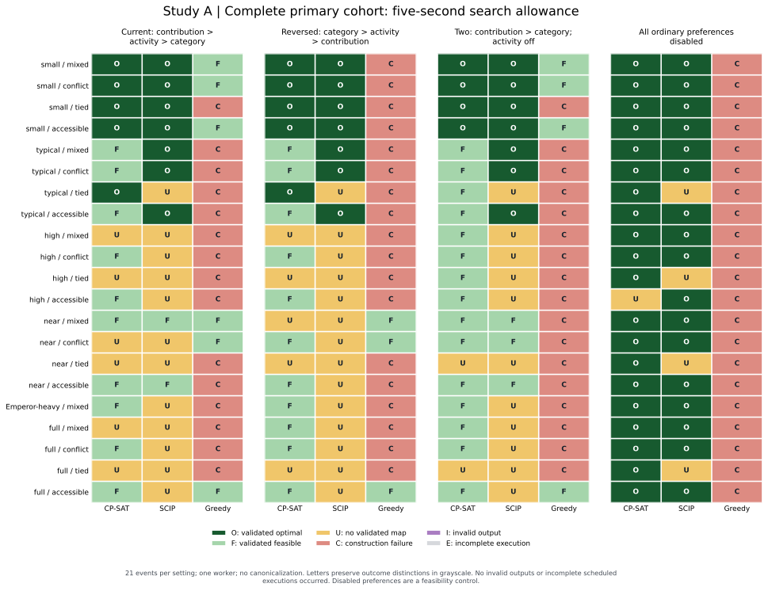
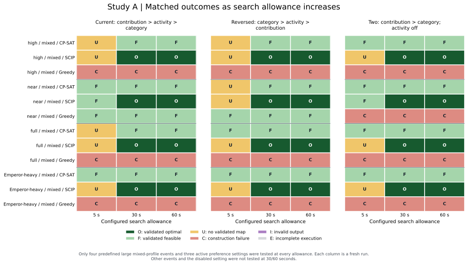
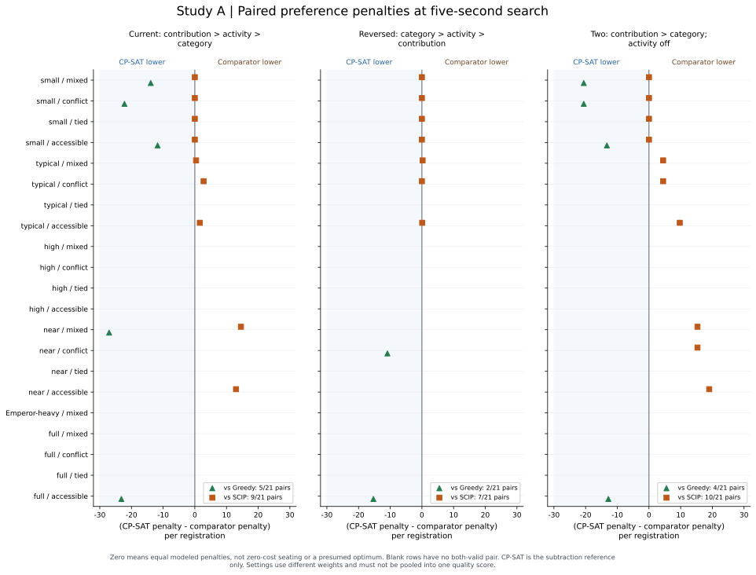
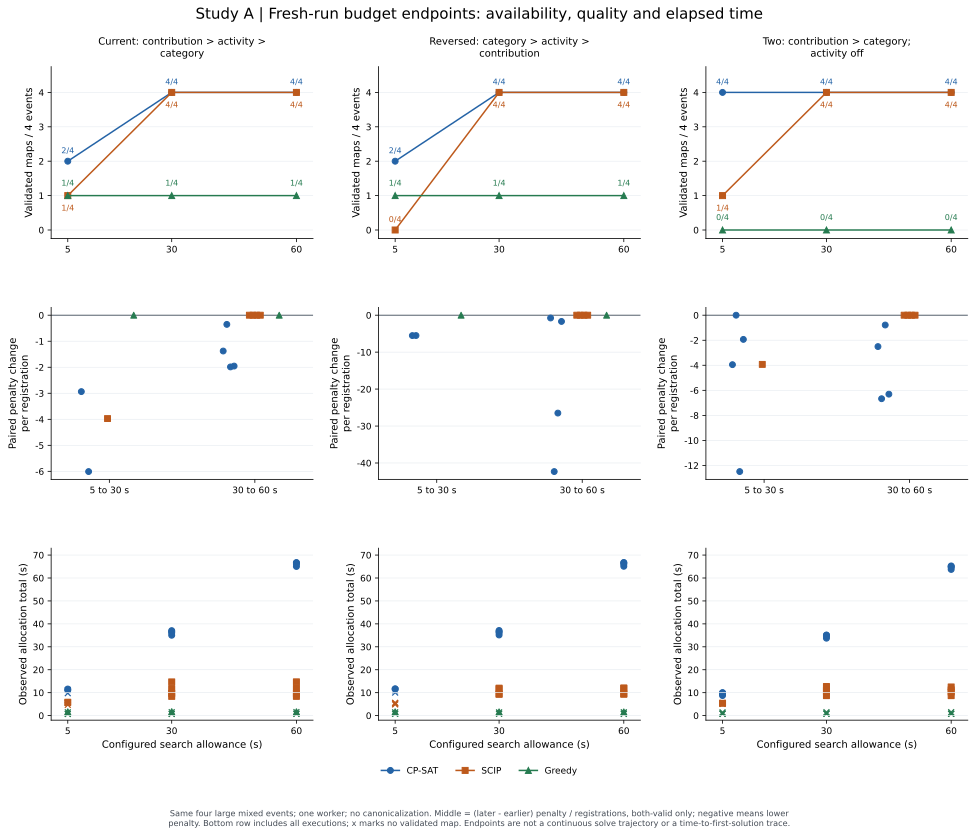
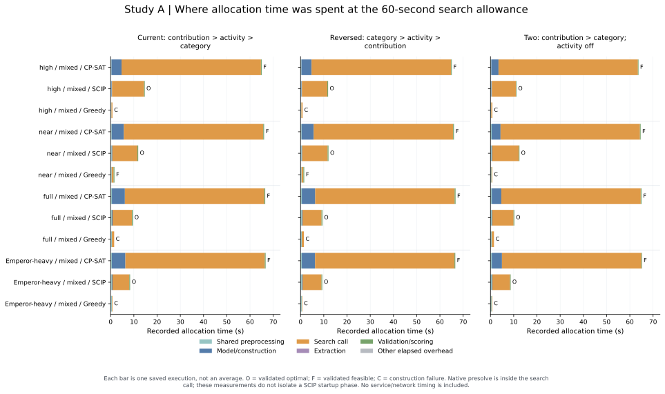
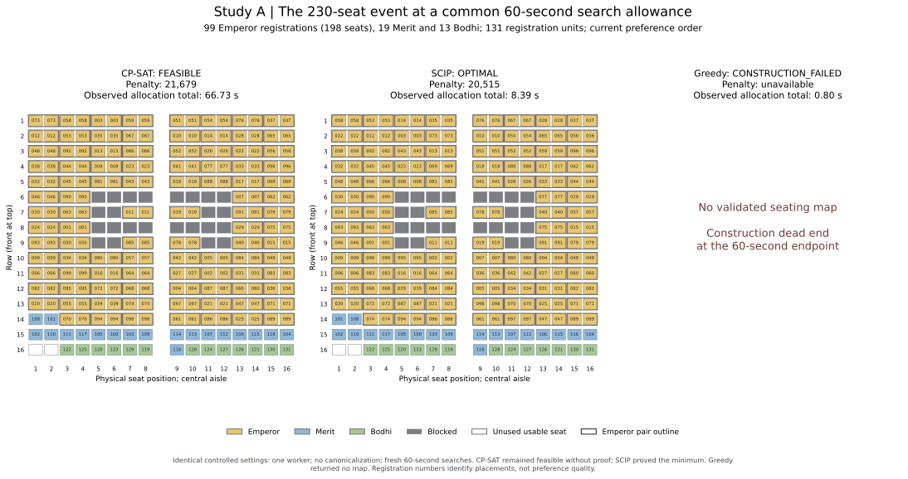

# Study A: solver-selection benchmark (v4, attempt 3) — results and discussion

*Follow-up update, 23 October 2026: Study B attempt 3 has since completed. See the [Study A–B synthesis](solver-selection-study-a-study-b-attempt3-synthesis.md) and [Study B interpretation](study-b-windows-2026-10-23-attempt3/interpretation.md) for the current initial-generation solver decision. Forward-looking Study B statements below describe the plan at the time this Study A chapter was written.*

*Dissertation and technical-paper source draft, revised 23 October 2026. This chapter interprets the completed attempt 3 experiment and the expanded A1–A6 figure package. The revision uses saved records only; no solver experiment was rerun. It supersedes the earlier five-second-based primary-solver recommendation. Study B was a separate, unexecuted production comparison when this chapter was drafted; its completed attempt 3 is linked above.*

## 1. Research question, evidence and scope

Study A investigated the suitability of three implemented allocation methods for the compulsory seating rules and configurable preferences of the PJKIT system: CP-SAT, SCIP and a deterministic constraint-aware greedy constructor. Suitability was assessed through complete-map availability, independently validated rule compliance, modeled preference penalty, proof of optimality and observed allocation time. The purpose was to compare candidates for the system, without assuming that the solver used in the prototype must be selected for production.

The main finding is conditional on the search allowance. **CP-SAT returned more complete validated maps at five seconds, while SCIP supplied stronger preference-quality and optimality results on the observed both-valid comparisons and on the predefined 30/60-second subset.** The greedy constructor was fast when successful but returned too few complete maps to support its selection as the sole initial allocator. These findings motivate a production comparison between CP-SAT and SCIP; they do not establish one solver as the overall production winner.

The primary evidence is the [completed attempt 3 bundle][evidence], originally recorded on Windows 11. Its [manifest][manifest], [run records][runs], [input inventory][inventory], [correctness audit][correctness] and [report audit][report-audit] provide the execution and validation trail. No observations from stopped attempts 1 or 2, development pilots, or a weighting experiment are pooled into the results below. The [expanded figure package][figures] is a presentation revision of these same observations, with derived tables and source hashes; it is not another experimental sample.

### 1.1 Experimental units and allocation demand

An event-setting combination is a matched case shared by the three methods. A trial is one method's execution on that case under one allowance. A registration unit is an entitlement-bearing registration, not necessarily one physical seat: an Emperor registration requires an approved two-seat pair, whereas a Merit or Bodhi registration requires one seat.

The 21 known-feasible synthetic events contain five demand families with four patterns each—mixed, conflict, tied and an accessibility derivative—plus one distinct Emperor-heavy mixed event:

| Event family | Registration units | Physical seat demand / 232 usable seats | Number of events |
| --- | ---: | ---: | ---: |
| Small | 24 | 32 / 232 | 4 |
| Typical | 96 | 152 / 232 | 4 |
| High occupancy | 117 | 179 / 232 | 4 |
| Near capacity | 139 | 212 / 232 | 4 |
| Full capacity | 152 | 232 / 232 | 4 |
| Emperor-heavy mixed | 131 | 230 / 232 | 1 |

These are related constructed scenarios, not 21 independently sampled real assemblies. Accessibility cases are derivatives of base events. Physical occupancy, registration count and Emperor registration share must therefore remain distinct in the interpretation.

### 1.2 Objective, settings and execution cohorts

All methods in a controlled matched case received the same effective input, declared compulsory rules and common scoring coefficients. The CP-SAT and SCIP encodings were intended to represent the same allocation model; correctness checks and independent returned-map validation support comparison of these implementations on the tested inputs. This is not a formal equivalence proof for every possible future input. The greedy method attempted to construct a legal allocation under the same rules and was scored by the same evaluator when it succeeded.

The benchmark used the following coefficients for normalized contribution, activity and category penalties:

| Setting | Contribution coefficient | Activity coefficient | Category coefficient | Preference order |
| --- | ---: | ---: | ---: | --- |
| Current | 4 | 3 | 2 | Contribution > activity > category |
| Reversed | 2 | 3 | 4 | Category > activity > contribution |
| Two | 4 | 0 | 3 | Contribution > category; activity disabled |
| Disabled | 0 | 0 | 0 | All ordinary preferences disabled |

Lower common penalty indicates a better value of this declared objective. The weights define compensatory trade-offs, not lexicographic commands: a higher-ranked preference has greater influence per comparable normalized penalty unit, while improvements in other components can offset a worsening in that component. A preference priority is not an additional compulsory rule. The value is neither monetary cost nor a measurement of attendee satisfaction. Disabling preferences retains compulsory rules, so the disabled setting is a feasibility/runtime control. Its zero preference objective cannot demonstrate superior preference quality. Penalty magnitudes must be compared within a fixed event and setting; different coefficient vectors must not be pooled into one average quality score.

| Cohort | Design | Recorded trials | Interpretation |
| --- | --- | ---: | --- |
| Primary controlled comparison | 21 events × 4 settings × 3 methods, five-second search allowance | 252 | 84 matched cases; 63 have active preferences |
| Longer-budget controlled comparison | 4 large mixed events × 3 active settings × 3 methods × 30/60-second allowances | 72 | 12 matched cases per allowance; five-second endpoints reuse primary records |
| Separate CP-SAT production-path checks | 4 mixed events, current setting, 60-second configuration | 4 | Different worker/canonical settings; diagnostic evidence only |
| Total | Distinct saved executions | 328 | These cohorts are not pooled into a solver success rate |

The 324 controlled trials used one worker, no hints and no canonicalization. The four older production-path checks used eight CP-SAT workers and requested canonicalization. They must be analyzed separately. There was one execution per case, method and allowance, with no repeated-seed design. The recorded environment was Windows 11 AMD64, Python 3.14.7, OR-Tools 9.15.6755 and SCIP 10.0.0 with SoPlex 8.0.0. These are the manifest's recorded versions, not claims about other installations.

All 328 scheduled jobs were attempted and completed; no invalid returned allocation or incomplete scheduled execution was recorded. Input-inventory and correctness gates passed, and the report audit counted all 328 records. The runner elapsed 4,045.05 seconds (67.42 minutes) within the amended 8,100-second ceiling. The [execution-coverage table][execution-coverage] distinguishes execution completion from map availability: a completed job can still return no map. Cases never scheduled at 30/60 seconds are not failures or missing executions.

### 1.3 Outcome definitions and clocks

A complete independently validated allocation is required before preference quality is evaluated. `FEASIBLE` denotes such a returned map without proof that its preference penalty is minimal. `OPTIMAL` adds the solver's reported proof of the declared objective minimum, subject to its numerical tolerances. In the controlled records, objective and best bound agree within 1e-6 objective units; one SCIP record has a floating-point gap of approximately 9e-13. Independent map validation establishes rule compliance; it is distinct from checking the solver's objective bound.

`UNKNOWN` means that the run did not establish a complete returned map. `CONSTRUCTION_FAILED` denotes a greedy dead end. Neither proves that the event is infeasible; these inputs have certified feasible witnesses. An invalid output would violate the independent audit, and an incomplete execution would mean a scheduled job did not finish. Neither occurred here. Incomplete **canonicalization**, discussed in Section 8, is a different condition again.

For controlled trials, the reported allowances are solver/search settings rather than one externally enforced allocation-service deadline. Observed allocation total includes recorded preprocessing, construction/model building, search, extraction and validation/scoring, with any residual overhead accounted for. Native internal time accounting is not separately profiled. Allocation total is not a complete web-request latency measurement, and a five-second search configuration need not return a result to a caller in five seconds. The current production example uses a different, shared allocation-function clock, making direct transfer of these elapsed times inappropriate. No staff response-time requirement has been established; the five-second experiment is not evidence of a five-second business deadline.

## 2. Figure A1: complete five-second outcome comparison

*Figure A1. Complete primary cohort, one worker and no canonicalization. Dark green/O denotes a validated optimal map; light green/F, a validated feasible map; amber/U, no validated map; red/C, construction failure; purple/I, invalid output; and gray/E, incomplete execution. The latter two outcomes did not occur. Each setting contains 21 attempted events per method. Sources: [run records][runs] and [execution coverage][execution-coverage].*

The event-by-method matrix preserves where each outcome occurred, including cases for which no cost exists. Letters retain the distinctions when printed without color. This representation complements the aggregate counts rather than allowing unsuccessful cases to disappear from a cost average.

*Table A1. Complete independently validated maps at the five-second search allowance. Each method-setting denominator is 21 attempted events.*

| Setting | CP-SAT valid / 21 | SCIP valid / 21 | Greedy valid / 21 |
| --- | ---: | ---: | ---: |
| Current | 15 (71.4%) | 9 (42.9%) | 6 (28.6%) |
| Reversed | 16 (76.2%) | 7 (33.3%) | 3 (14.3%) |
| Two preferences | 19 (90.5%) | 10 (47.6%) | 4 (19.0%) |
| All disabled | 20 (95.2%) | 17 (81.0%) | 0 (0%) |

Across the three active settings, CP-SAT returned 50/63 validated maps (79.4%), SCIP 26/63 (41.3%) and greedy 13/63 (20.6%). Including the disabled control gives 70/84 (83.3%), 43/84 (51.2%) and 13/84 (15.5%), respectively. The active-setting denominator is the relevant preference-aware summary. The disabled results are retained as a separate control, not extra evidence of preference quality.

Among the active-setting trials, CP-SAT produced 14 `OPTIMAL`, 36 `FEASIBLE` and 13 no-map outcomes. SCIP produced 21 `OPTIMAL`, five `FEASIBLE` and 37 no-map outcomes. Greedy produced 13 `FEASIBLE` outcomes and 50 construction failures. Thus CP-SAT's five-second advantage concerned availability, while SCIP supplied both a larger number of proven optima and a larger proof fraction among its returned maps: 21/26 versus CP-SAT's 14/50. The latter fractions are conditional on successful return, not overall success rates.

Greedy's zero successes in the disabled setting show that removing ordinary preference optimization did not resolve this constructor's difficulties with the compulsory joint assignment problem. However, it did not lose every comparison. It returned a map for `near-conflict/current` and `near-mixed/reversed` when neither exact method returned one at five seconds. Such exceptions prevent a claim of strict case-by-case dominance by either exact implementation. These observations describe the tested executions; without repetitions they do not estimate future-event reliability.

## 3. Figure A2: matched outcomes at 5, 30 and 60 seconds

*Figure A2. Fresh-run budget endpoints for `high-mixed`, `near-mixed`, `full-mixed` and `heavy-mixed`, under current, reversed and two-preference settings. Status meanings match Figure A1. Five-second cells reuse primary executions; 30/60-second cells are additional runs. Other events and the disabled setting were not tested at longer allowances. Source: [matched-budget outcome table][matched-outcomes].*

This matrix places short- and longer-allowance results side by side for the same cases. It shows why the full five-second cohort and the smaller longer-budget cohort must retain separate denominators. A 30/60-second outcome matrix for all 21 events cannot be reconstructed from the available records.

*Table A2. Validated-map counts on four events per active setting at each allowance.*

| Setting | CP-SAT valid at 5 / 30 / 60 s | SCIP valid at 5 / 30 / 60 s | Greedy valid at 5 / 30 / 60 s |
| --- | ---: | ---: | ---: |
| Current | 2 / 4 / 4 | 1 / 4 / 4 | 1 / 1 / 1 |
| Reversed | 2 / 4 / 4 | 0 / 4 / 4 | 1 / 1 / 1 |
| Two preferences | 4 / 4 / 4 | 1 / 4 / 4 | 0 / 0 / 0 |
| All 12 matched cases | 8 / 12 / 12 | 2 / 12 / 12 | 2 / 2 / 2 |

CP-SAT gained four validated maps and SCIP gained ten between five and 30 seconds; neither lost a previously available map. Both reached 12/12 at 30 and 60 seconds. Their proof outcomes differed: all 12 CP-SAT maps at each longer allowance remained `FEASIBLE`, while all 12 SCIP maps at each were `OPTIMAL`. Every longer-budget greedy execution reproduced either its successful construction or a dead end, leaving availability at 2/12.

Accordingly, the strongest longer-budget finding is not merely that SCIP eventually returned some maps. **On this predefined 12-case subset, it attained the same complete-map coverage as CP-SAT and proved every returned objective minimum at both longer allowances.** This result does not establish the same behavior for untested longer-budget conflict, tied or accessibility scenarios.

## 4. Figure A3: paired preference penalties at five seconds

*Figure A3. `(CP-SAT penalty − comparator penalty) / registrations`, conditional on both methods returning independently validated maps for the same event and setting. Negative values favor CP-SAT, positive values favor its comparator and zero denotes equality. Blank rows have no both-valid pair. Sources: the [original paired table][original-pairs] and its [cross-checked presentation table][paired-table].*

CP-SAT is the arithmetic subtraction reference in this plot. The zero line is neither CP-SAT's absolute penalty nor a presumed optimum. Reversing the subtraction would reverse the signs without changing the ranking. Dividing by registration units permits an event-size-normalized difference, including one registration for each Emperor pair. It does not remove differences between preference coefficient vectors, so settings remain separate panels.

*Table A3. Both-valid five-second comparisons. Lower/equal/higher refers to CP-SAT's penalty relative to the named comparator.*

| Setting | Comparator | Both-valid pairs / 21 | CP-SAT lower / equal / higher | Median difference per registration |
| --- | --- | ---: | ---: | ---: |
| Current | Greedy | 5 | 5 / 0 / 0 | −22.21 |
| Current | SCIP | 9 | 0 / 4 / 5 | +0.40 |
| Reversed | Greedy | 2 | 2 / 0 / 0 | −13.10 |
| Reversed | SCIP | 7 | 0 / 5 / 2 | 0.00 |
| Two preferences | Greedy | 4 | 4 / 0 / 0 | −16.94 |
| Two preferences | SCIP | 10 | 0 / 4 / 6 | +4.47 |

CP-SAT had lower penalty in all 11 both-valid comparisons against greedy. This supports the prediction of improved modeled preference quality over the implemented greedy baseline when both methods supplied maps. It does not assign quality values to greedy's failures or establish a common improvement magnitude for all 63 active cases. Greedy returned faster than CP-SAT in all 11 of these paired observations, demonstrating an observed speed–quality trade-off even within successful executions.

Against SCIP, CP-SAT had lower penalty in none of the 26 both-valid pairs, tied in 13 and had higher penalty in 13. This evidence does not support an overall claim that CP-SAT delivered the best preference quality. The statement is conditional on both-valid return: it cannot substitute for CP-SAT's broader five-second availability, and it cannot be extended to costs that were never observed. A tie also need not mean that both methods proved optimality or selected the same physical map; objective value, proof status and placement identity are separate outcomes.

## 5. Figure A4: budget response in availability, penalty and elapsed time

*Figure A4. The same four large mixed events in each active-setting panel. The upper row counts validated maps; the middle row shows `(later penalty − earlier penalty) / registrations` only for both-valid endpoints; the lower row shows observed allocation total for every execution, with `×` marking no validated map. Negative penalty change indicates a lower later penalty. Sources: [budget contrasts][budget-contrasts] and [run records][runs].*

The columns compare independent fresh executions at different configured allowances. Connecting coverage endpoints helps compare the design settings; it does not trace one continuous solve. Likewise, a later valid result does not identify when the earlier run would first have found a feasible incumbent or an optimum.

Among both-valid CP-SAT endpoints, penalty decreased in seven of eight 5→30-second comparisons, with one tie and a median change of −4.73 units per registration. It decreased in all 12 30→60-second comparisons, with a median change of −1.97. SCIP improved its two available 5→30-second pairs, with a median change of −3.95, and had 12 ties from 30 to 60 seconds after establishing optimality. These medians summarize the displayed matched changes; they do not create a universal quality scale across settings.

At 30 seconds, CP-SAT's penalty exceeded SCIP's in all 12 matched cases. At 60 seconds, it exceeded SCIP's in 11 and tied in `high-mixed/reversed`. CP-SAT still reported `FEASIBLE` in that tied case. The later SCIP proof establishes that the equal-valued CP-SAT incumbent also attained the common objective minimum for that case, assuming the shared model/scorer equivalence; CP-SAT had not itself established that proof within its run. An unproved result is therefore not necessarily suboptimal, although the other 11 comparisons demonstrate an observed penalty gap.

*Table A4. Median observed allocation total in seconds on the same 12 matched cases. All executions are included, including no-map outcomes; these are not medians of successful response times alone.*

| Configured search allowance | CP-SAT | SCIP | Greedy |
| --- | ---: | ---: | ---: |
| 5 s | 10.52 | 5.42 | 0.88 |
| 30 s | 35.62 | 10.80 | 0.90 |
| 60 s | 65.64 | 10.76 | 0.86 |

CP-SAT's rising allocation totals reflect search calls that generally consumed the larger allowances; the later endpoints contained lower penalties without a completed proof. SCIP's 30- and 60-second totals were similar because those runs terminated after proving optimality rather than consuming the full available limit. Greedy terminated on success or an irreversible construction failure, so increasing an upper allowance did not cause it to continue revising its commitments.

All 12 exact-method outcomes at 30/60 seconds were valid, allowing a direct elapsed-time comparison on this subset. At 30 seconds, CP-SAT totals ranged from 33.76 to 37.10 seconds, versus SCIP's 8.37–14.70. At 60 seconds they ranged from 63.74 to 66.74, versus SCIP's 8.39–14.71. SCIP was faster in every matched comparison at both longer allowances. Greedy's shorter elapsed time frequently measured a failed attempt, so it must be read alongside its 2/12 coverage rather than presented as a faster complete-result service.

The data show that the five-second allowance was insufficient for many SCIP cases in this setup. They do **not** show that SCIP inherently requires 30 seconds, that it cannot produce an earlier feasible map, or that a startup delay caused its failures. One fresh execution per endpoint cannot estimate runtime variance, tail latency or a general time-to-first-map curve.

## 6. Figure A5: recorded timing phases at the 60-second allowance

*Figure A5. Disjoint recorded phases for four events × three active settings × three methods at the 60-second search allowance. Bars include preprocessing, model/construction, search call, extraction, validation/scoring and residual elapsed overhead. Each bar is an execution rather than an average. O/F/C denote validated optimal, validated feasible and construction failure. Source: [phase-timing table][phase-table]. No network or full web-service latency is represented.*

The phase view explains part of the observed total-time difference without attributing all elapsed time to search. Across the 12 CP-SAT 60-second cases, model building took 3.11–5.83 seconds and search 60.01–60.05 seconds. The corresponding SCIP ranges were 0.21–0.34 seconds for model building and 7.23–13.79 seconds for search. These are properties of the tested encodings and implementation pipeline on this environment, not universal constants for either solver.

Native SCIP presolve is included within the search call; the saved measurements do not isolate it as a separate startup phase. The Emperor-heavy current-setting example makes the distinction explicit:

*Table A5. SCIP timing on `heavy-mixed/current`; all three endpoints are separate fresh runs. Values are seconds, rounded to three decimals.*

| Search allowance | Result | Model build | Search call | Allocation total |
| --- | --- | ---: | ---: | ---: |
| 5 s | `UNKNOWN`, no map | 0.334 | 4.634 | 5.483 |
| 30 s | `OPTIMAL` | 0.295 | 7.211 | 8.370 |
| 60 s | `OPTIMAL` | 0.290 | 7.229 | 8.390 |

This shows a validated optimum returned in about 8.4 seconds by a run configured to allow up to 30 or 60 seconds. It does not identify the moment when the first feasible or optimal incumbent appeared. The controlled records do not provide comparable first-incumbent timestamps for both exact backends. Allocation total, search-call duration, the time of proving the weighted optimum, and first encountering an optimal incumbent must therefore not be relabeled as interchangeable measurements. Figure A5 is useful supporting evidence or an appendix figure when space in the technical paper is limited.

## 7. Figure A6: the 230-seat case at a common 60-second endpoint

*Figure A6. `heavy-mixed/current` under identical controlled settings: one worker, no canonicalization and a fresh 60-second search allowance. CP-SAT returned a validated FEASIBLE map, SCIP a validated OPTIMAL map and greedy no map. Yellow indicates Emperor seats, blue Merit, green Bodhi, gray blocked positions and white unused usable seats; outlines identify Emperor pairs. Sources: [saved endpoint table][heavy-table], the saved placements and their independent audits.*

The event has 99 Emperor registrations requiring 198 seats, 19 Merit registrations and 13 Bodhi registrations: 131 registration units occupying 230 of 232 usable seats. Only two usable seats remain empty. It is an Emperor-heavy stress case, not a representative sample of typical PJKIT assemblies. The selected plotted maps were checked for registration coverage, entitlement, seat uniqueness, blocked seats, accessibility and approved pairs against their saved audits and records.

The common 60-second endpoint replaces the earlier five-second-only main illustration so that the physical comparison reflects both solvers' longer-budget results. It does not replace CP-SAT's saved FEASIBLE map with an unobserved optimal map or with a differently configured production run. The complete endpoint history remains visible below.

*Table A6. The 230-seat current-setting case across search allowances. Penalty is unavailable when no validated map was returned; elapsed values are observed allocation totals, not the configured limits.*

| Method | Allowance | Returned outcome | Common penalty | Allocation total (s) |
| --- | ---: | --- | ---: | ---: |
| CP-SAT | 5 s | `FEASIBLE` | 22,722 | 11.566 |
| CP-SAT | 30 s | `FEASIBLE` | 21,935 | 37.035 |
| CP-SAT | 60 s | `FEASIBLE` | 21,679 | 66.729 |
| SCIP | 5 s | `UNKNOWN`, no map | Unavailable | 5.483 |
| SCIP | 30 s | `OPTIMAL` | 20,515 | 8.370 |
| SCIP | 60 s | `OPTIMAL` | 20,515 | 8.390 |
| Greedy | 5 s | `CONSTRUCTION_FAILED` | Unavailable | 0.820 |
| Greedy | 30 s | `CONSTRUCTION_FAILED` | Unavailable | 0.793 |
| Greedy | 60 s | `CONSTRUCTION_FAILED` | Unavailable | 0.797 |

CP-SAT established a complete map in the five-second run when SCIP did not, supporting its short-allowance availability advantage on this case. SCIP subsequently established the common minimum of 20,515 at both longer endpoints and returned sooner than CP-SAT's corresponding runs. Relative to that minimum, CP-SAT's five-second penalty was 2,207 units higher (10.76%); at 60 seconds it was 1,164 units higher (5.67%). These percentages quantify the modeled penalty gap, not an improvement in human satisfaction.

Greedy's failure at every allowance is consistent with the risk of irreversible local commitments in a highly occupied joint assignment problem. The records do not isolate a particular seating constraint as the cause, so pair placement, ordering or packing must not be presented as a demonstrated single causal trigger. The missing panel denotes no complete validated allocation, not zero penalty and not proof of event infeasibility.

No controlled CP-SAT optimum was established for this event by 60 seconds. Consequently, Study A cannot provide a comparable "time to an optimal seating map" for both methods on this case. It can report the saved endpoint maps, penalties, proof statuses and total times above. Registration labels in the diagram identify assignments; their positions alone do not establish preference quality, which is evaluated through the common scorer.

## 8. Separate production-path diagnostics and reproducibility

The four older CP-SAT production-path checks used current preferences on `high-mixed`, `near-mixed`, `full-mixed` and `heavy-mixed`, with eight workers, canonicalization requested and a 60-second configuration. Their outcomes are relevant to integration but are excluded from Figures A1–A6 and the controlled comparisons because their settings and clocks differ.

*Table A7. Separate historical CP-SAT production checks. Common penalty is independently rescored on the benchmark scale; service return and externally audited allocation total are separate clocks. All four returned valid maps and proved the weighted preference objective, while canonicalization remained incomplete.*

| Event | Common penalty | Weighted-objective proof | Canonicalization complete | Service return (s) | Including external audit/persistence (s) |
| --- | ---: | --- | --- | ---: | ---: |
| High mixed | 19,093 | `OPTIMAL` | No | 62.552 | 62.919 |
| Near mixed | 23,194 | `OPTIMAL` | No | 62.510 | 62.941 |
| Full mixed | 24,959 | `OPTIMAL` | No | 62.600 | 63.070 |
| Emperor-heavy mixed | 20,515 | `OPTIMAL` | No | 62.487 | 62.897 |

Sources are the [high][prototype-high], [near][prototype-near], [full][prototype-full] and [Emperor-heavy][prototype-heavy] raw prototype records. Each contains a zero-gap `weighted_preferences` proof and `canonicalization_complete: false`. Their common penalties equal the corresponding controlled SCIP current-setting optima. The native production objective values are ten times the common benchmark values under the current 40:30:20 versus 4:3:2 coefficient scales. Positive uniform scaling preserves the mathematical preference minimizer, but these records do not isolate scaling, worker count or other integration differences as a cause of performance.

The distinction between weighted optimality and canonical completion is essential. Two allocations can have the same minimum penalty while placing particular registrations differently, where compulsory rules allow both assignments. For example, swapping two equivalent single-seat registrations between equivalent legal positions can leave the objective unchanged. Canonicalization applies a shared ordered tie-break to select one physical map among equally preferred alternatives. A weighted `OPTIMAL` status alone does not establish that this selection finished.

These checks therefore demonstrate that the production CP-SAT path could return valid, preference-optimal maps on four selected inputs. They do not establish exact repeated-map reproducibility, successful canonical completion, or controlled superiority over SCIP. The saved proof records do not provide a comparable weighted-proof completion timestamp, so the full service times must not be described as exact time-to-first-optimum measurements. No unchanged-input repetition or semantic input-permutation experiment was conducted in Study A.

Under the proposed Study B acceptance contract, incomplete canonicalization must not replace the map; an existing map may instead be preserved. That is a future integration gate, not a retrospective assertion that these four historically returned maps violated compulsory seating rules. Nor are they Study B results. **Four completed jobs with incomplete canonicalization must not be counted as four incomplete executions or invalid allocations in Study A.**

## 9. Integrated interpretation for the seating allocation model

### 9.1 Feasibility, preference quality and proof answer different questions

The results support separating three claims. A validated map establishes that the implemented compulsory rules were satisfied for the returned allocation. Its penalty describes performance under the chosen preference coefficients. A proof establishes that no lower value exists within the declared model, subject to solver correctness and tolerances. A valid unproved map can be useful without being certified best, and a lower penalty does not imply fewer hard-rule violations: every map admitted to the quality comparison already passed the hard-rule audit.

This separation also bounds the theoretical interpretation. CP-SAT and SCIP are solution technologies for encodings of the allocation problem; the mathematical allocation rules and objective do not become a different research problem simply because another solver is used. In the current setting, for example, the common objective combines contribution, activity and category penalties with coefficients 4, 3 and 2 over the same declared feasible allocations. Search efficiency, incumbent discovery and proof completion can differ even when that mathematical target is shared. Study A provides computational evidence for these implemented encodings on fixed cases, not a theorem that one solver family always dominates another.

### 9.2 Solver suitability depends on the operational contract

If the decision criterion is the greatest observed complete-map coverage under the controlled five-second search allowance, CP-SAT is the strongest of the tested implementations. That is the supported scope of its availability advantage. It does not establish the fastest complete result, the lowest penalty, or a production default under the project's 60-second function configuration. No confirmed staff deadline gives five-second availability overriding business importance.

On the tested 30/60-second subset, SCIP provides the stronger combined controlled result: the same 12/12 validated coverage, proof of all 12 objective minima, equal or lower penalties and shorter observed allocation times in every matched comparison. Calling it merely an optional prover would understate these observations. Conversely, extrapolating these 12 mixed-profile cases to a universally better production service would exceed the experiment's coverage. CP-SAT's eight-worker production diagnostics also show why the single-worker comparison cannot settle performance under another configuration, while their incomplete canonicalization leaves the reproducibility requirement unresolved.

The implemented greedy constructor is not retained as the sole production initial-allocation candidate because its coverage was low and additional allowance did not repair its dead ends. This is a shortlist decision based on the observed coverage/quality trade-offs. It is not a claim that greedy lost every metric, that it never solved a case missed by the exact methods, or that every possible greedy algorithm is unsuitable.

### 9.3 Optimality evidence does not prescribe a two-solver production pipeline

A SCIP proof applies to the shared mathematical objective and feasible set. Where a separately validated CP-SAT incumbent has the same common value, the evidence can establish its objective optimality under those equivalence assumptions, as illustrated by the tied 60-second case. It does not automatically establish that the two physical maps match or that canonical selection completed.

Study A does not implement or compare a live CP-SAT-plus-SCIP certification pipeline. Such a pipeline would require compatible encodings, score and placement mapping, validation and a shared total-time policy. The results therefore neither require CP-SAT to remain the generator with SCIP used only for proof nor establish that this combination is preferable to SCIP as the initial solver. Production architecture remains a separate empirical and integration decision.

## 10. Limitations and threats to interpretation

The results are descriptive for related synthetic known-feasible events on one recorded Windows environment. They do not estimate performance over the population of PJKIT assemblies. A single execution per case-method-allowance provides no estimate of repeated-run variance, robustness to input order or tail latency; a fixed seed and one worker are insufficient evidence of exact physical-map reproducibility. Known-feasible tests also do not characterize infeasibility detection on impossible operational inputs.

Longer allowances were tested only on four large mixed-profile events and three active settings. Conflict, tied, accessibility and disabled cases outside this subset cannot be assigned inferred 30/60-second outcomes. Related configurations and event derivatives are not independent replications, so no significance test or population confidence interval is claimed. Conditional both-valid cost comparisons omit unsuccessful pairs by necessity; availability and exclusion counts remain necessary alongside them.

The common objective uses assumed preference coefficients and modeled normalized penalties. It was not validated against attendee experience or staff satisfaction, and an optimal result is optimal for the encoded objective, not proof that all real-world preferences were captured. Disabled preferences produce no meaningful quality ranking. Different setting scales, production objective scales and method-specific missing costs must not be merged into one universal score.

Elapsed-time findings combine the particular model encodings, preprocessing, solver configuration and implementation on the recorded environment. They do not isolate solver internals, startup, hardware effects or a guaranteed business response time. Controlled search allowances differ from a shared production-function allowance. Comparable first-feasible, first-optimal-incumbent and weighted-proof timestamps are unavailable; independent endpoints cannot reconstruct an anytime trajectory. Repeated equality of a cost at 30 and 60 seconds is not a repeated-input map determinism test.

Finally, the four production checks used different settings and incomplete canonicalization. Study A contains no production SCIP service comparison, no CP-SAT/SCIP regeneration bridge evaluation and no comparative absence-repair experiment. Claims about regeneration after preference changes, absence repair, exact map stability or production adoption must be supported by the corresponding implementation and evidence, not inferred from initial-allocation optima.

## 11. Study A conclusion and the separate role of Study B

Study A identifies a search-allowance-dependent trade-off. CP-SAT returned the most complete validated maps at five seconds across the active configurations. SCIP never had a higher penalty in the 26 observed both-valid five-second comparisons and, on the predefined longer-budget subset, reached complete coverage with proven optima and shorter observed allocation times. The tested greedy constructor's low coverage and poorer both-valid penalties justify excluding it as the sole production initial allocator, while preserving its speed advantage and exceptional successes in the discussion.

**The defensible conclusion is to retain CP-SAT and SCIP for production evaluation, rather than declare CP-SAT the overall primary solver from Study A.** SCIP's longer-budget results give it a strong evidence-based claim to that evaluation. The project title commits to configurable constraint optimization, not a particular solver brand; the existing prototype implementation is not itself evidence of comparative suitability. The subsequent Study B selection uses its agreed validity, preference quality, proof and complete-result-time contract; exact repeated maps can be handled at the application state/cache level, which this benchmark did not test.

The [original Study B protocol][study-b] proposed a production initial-allocation comparison to address this uncertainty. Its canonical selection and regeneration provisions were later revised under the agreed initial-generation selection contract. The completed [attempt 3 protocol](../planning/solver-selection-production-attempt3.md) and [cross-study synthesis](solver-selection-study-a-study-b-attempt3-synthesis.md) provide the current result. This Study A chapter itself contains no Study B performance conclusion.

## Figure use and evidence references

Use Figures A1 and A2 for availability and proof, A3 for conditional preference quality, A4 for budget response and actual elapsed time, and A6 for the main physical illustration. Figure A5 can support a timing-focused discussion or an appendix. All six have PDF/SVG/PNG exports and a [combined vector PDF][combined-pdf]. The old four-figure package remains historical evidence; it should not be mixed with A numbering without updating captions and references. For a shorter technical paper, figures can be selected for space, while preserving the subset denominators, failed/no-map outcomes and distinction between Study A and Study B.

[evidence]: solver-selection-v4-21-events-135m-windows-main-2026-10-20-attempt3/
[manifest]: solver-selection-v4-21-events-135m-windows-main-2026-10-20-attempt3/manifest.json
[runs]: solver-selection-v4-21-events-135m-windows-main-2026-10-20-attempt3/tables/run-records.csv
[inventory]: solver-selection-v4-21-events-135m-windows-main-2026-10-20-attempt3/inventory.json
[correctness]: solver-selection-v4-21-events-135m-windows-main-2026-10-20-attempt3/correctness.json
[report-audit]: solver-selection-v4-21-events-135m-windows-main-2026-10-20-attempt3/report-status.json
[figures]: solver-selection-v4-attempt3-figures-2026-10-23/README.md
[execution-coverage]: solver-selection-v4-attempt3-figures-2026-10-23/tables/execution-coverage.csv
[matched-outcomes]: solver-selection-v4-attempt3-figures-2026-10-23/tables/matched-budget-outcomes.csv
[original-pairs]: solver-selection-v4-21-events-135m-windows-main-2026-10-20-attempt3/tables/paired-costs.csv
[paired-table]: solver-selection-v4-attempt3-figures-2026-10-23/tables/paired-costs.csv
[budget-contrasts]: solver-selection-v4-attempt3-figures-2026-10-23/tables/budget-contrasts.csv
[phase-table]: solver-selection-v4-attempt3-figures-2026-10-23/tables/phase-timing-60s.csv
[heavy-table]: solver-selection-v4-attempt3-figures-2026-10-23/tables/230-seat-endpoints.csv
[prototype-high]: solver-selection-v4-21-events-135m-windows-main-2026-10-20-attempt3/runs/prototype__high-mixed__current__cp_sat__60s.json
[prototype-near]: solver-selection-v4-21-events-135m-windows-main-2026-10-20-attempt3/runs/prototype__near-mixed__current__cp_sat__60s.json
[prototype-full]: solver-selection-v4-21-events-135m-windows-main-2026-10-20-attempt3/runs/prototype__full-mixed__current__cp_sat__60s.json
[prototype-heavy]: solver-selection-v4-21-events-135m-windows-main-2026-10-20-attempt3/runs/prototype__heavy-mixed__current__cp_sat__60s.json
[study-b]: ../planning/solver-selection-production-follow-up.md
[combined-pdf]: solver-selection-v4-attempt3-figures-2026-10-23/attempt3-figure-package.pdf
