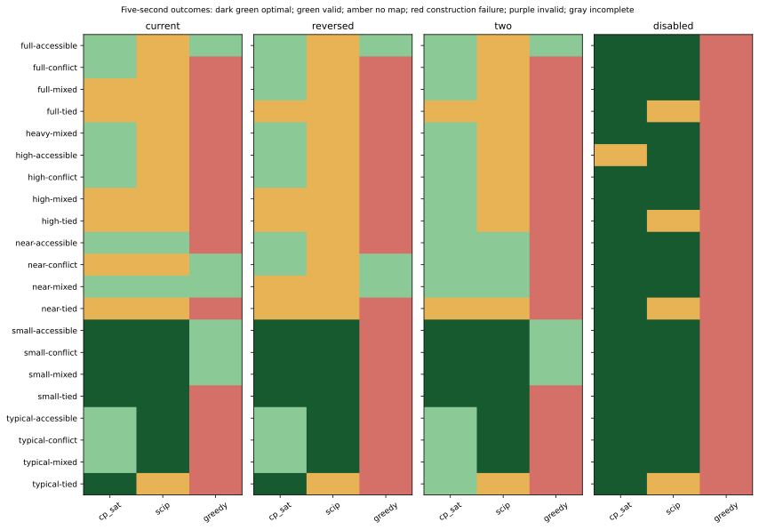
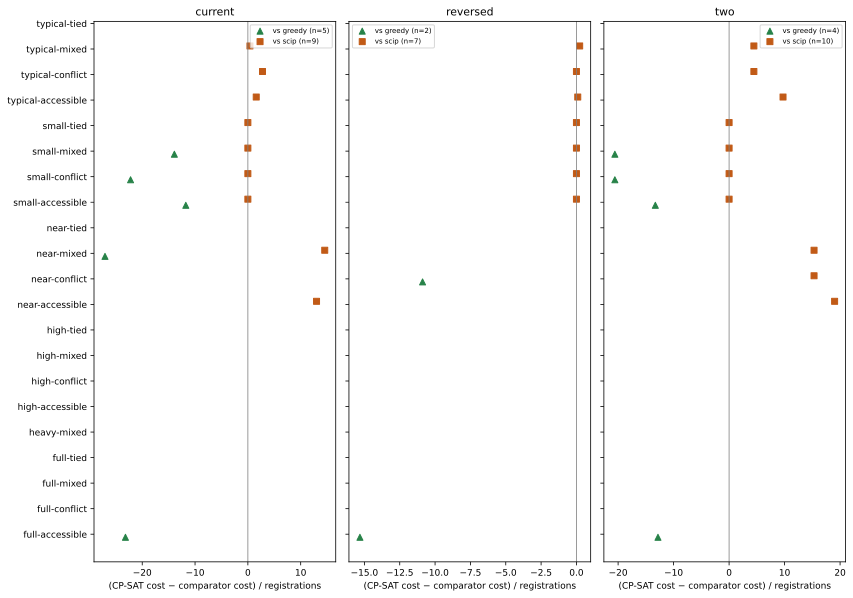
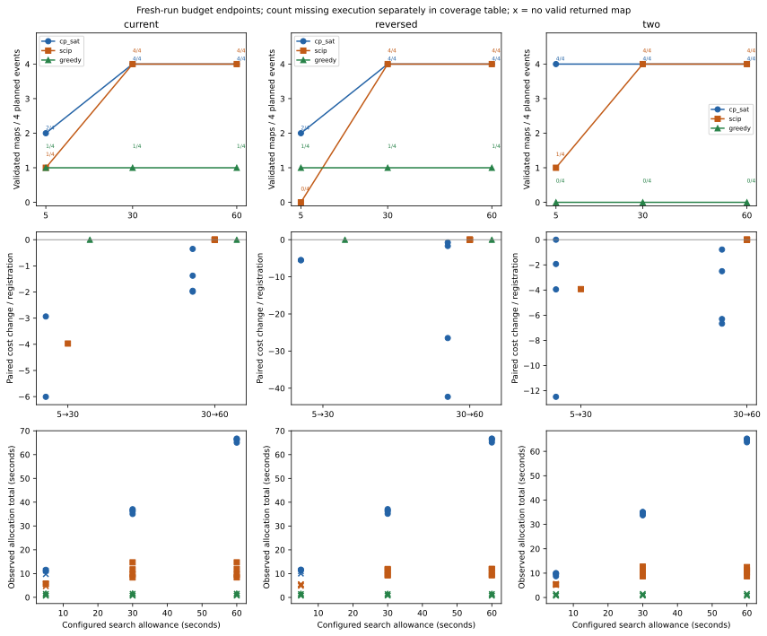
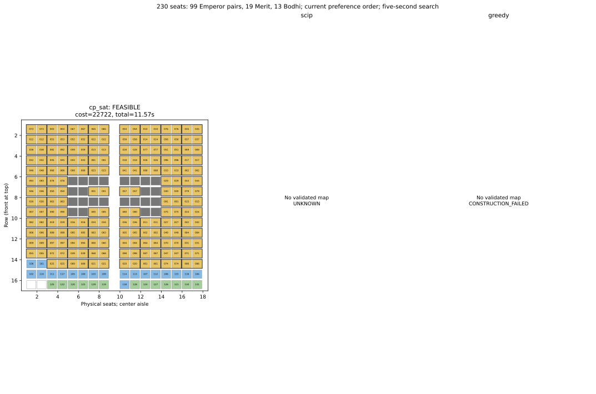

# Solver-selection benchmark (v4, attempt 3): results and discussion

*Dissertation and technical-paper draft, 21 October 2026. The evidence is the completed Windows 11 bundle at `D:\web-projects\FYP-Seating-Allocation\docs\results\solver-selection-v4-21-events-135m-windows-main-2026-10-20-attempt3`. Figure and table names below refer to files in that bundle. This analysis supersedes the interpretation of the stopped first attempt; no observations from that attempt are pooled here.*

## Study scope and interpretation of outcomes

The experiment compared the maintained constraint-programming model solved by CP-SAT, a mathematically equivalent mixed-integer formulation solved by SCIP, and a deterministic constraint-aware greedy constructor. All three methods received the same synthetic event, compulsory seating rules, preference configuration and scoring coefficients in each matched comparison. The controlled runs used one solver worker, no hints and no canonicalization. An independently validated *complete* allocation was the prerequisite for evaluating preference cost. A `FEASIBLE` status establishes a valid returned map without proving minimum cost; `OPTIMAL` additionally certifies the minimum of the declared model objective. `UNKNOWN` and `CONSTRUCTION_FAILED` indicate that the respective run returned no complete validated map. Neither status proves that the event itself is infeasible.

The 21 known-feasible events comprise the original 13 cases and eight added high-occupancy or near-capacity cases. Each was tested under four preference settings: **current** (contribution > activity > category), **reversed** (category > activity > contribution), **two** (contribution > category, with activity disabled), and **disabled** (ordinary preferences disabled). The last setting retains all compulsory rules and serves as a feasibility and runtime control; its zero ordinary-preference objective provides no meaningful comparison of preference quality. The fixed current-ratio weighting rule was held constant within each setting. The primary design therefore comprised 21 events × four settings × three methods = 252 five-second searches. The prespecified longer-budget subset comprised four mixed-profile large events × three active settings × three methods at 30 and 60 seconds, adding 72 fresh searches; its five-second endpoints reuse the primary records. Four separate production-path CP-SAT checks completed the 328-job main study. These four checks used eight workers and canonicalization and are not pooled with controlled solver comparisons.

The run manifest records `completed` and a finished report; the report audit found 328 records, and both input-inventory and correctness gates passed. Every scheduled primary and longer-budget trial was attempted. The runner elapsed 4,045.05 seconds (67.42 minutes) within the amended 8,100-second ceiling. All reported rates and costs below are **descriptive results for these related synthetic cases**, not population estimates.

## Figure 1 — Five-second validated-map outcomes

*Figure 1. Five-second solver outcomes for 21 events under four preference settings. Dark green denotes a validated optimal map; light green, a validated feasible map; amber, no returned map; and red, greedy construction failure. Source: `tables/coverage.csv` and `tables/run-records.csv` in the attempt 3 evidence bundle.*

**Representation and rationale.** The four-panel event-by-method status matrix aligns matched cases row by row. Its separate colours distinguish proven optimal maps, valid but unproven maps, no returned map, and greedy construction failures. This form was chosen in place of a single average success rate because it retains the location and type of every failure, including cases for which no preference score exists.

*Table 1. Number and percentage of independently validated maps returned within the five-second search allowance; each cell has 21 attempted events.*

| Preference setting | CP-SAT valid / 21 | SCIP valid / 21 | Greedy valid / 21 |
|---|---:|---:|---:|
| Current | 15 (71.4%) | 9 (42.9%) | 6 (28.6%) |
| Reversed | 16 (76.2%) | 7 (33.3%) | 3 (14.3%) |
| Two preferences | 19 (90.5%) | 10 (47.6%) | 4 (19.0%) |
| All disabled | 20 (95.2%) | 17 (81.0%) | 0 (0%) |

Across the three preference-active settings, CP-SAT returned 50 validated maps in 63 trials (79.4%), compared with 26/63 (41.3%) for SCIP and 13/63 (20.6%) for greedy. Including the all-disabled control gives 70/84 (83.3%), 43/84 (51.2%) and 13/84 (15.5%), respectively. The active-setting denominator is the more relevant summary for preference-aware allocation, while the control shows how the methods respond when preference optimization is removed. For example, CP-SAT succeeded in 20/21 and SCIP in 17/21 disabled cases, whereas the unchanged greedy constructor succeeded in none. This supports the interpretation that greedy's construction strategy struggles with the compulsory joint assignment rules; preference weighting alone cannot explain its failures. It does **not** show that those events have no valid seating plan, because the exact methods produced validated maps for many of them.

Solution availability and proof strength must remain distinct. In the current setting, CP-SAT's 15 successes comprised five `OPTIMAL` and ten `FEASIBLE` outcomes; SCIP's nine successes comprised seven `OPTIMAL` and two `FEASIBLE` outcomes. In the reversed setting all seven valid SCIP outcomes were proven optimal, versus five of 16 valid CP-SAT outcomes. Thus CP-SAT's principal five-second advantage was **more frequent return of a usable map**, whereas SCIP more often supplied a proof among the maps it returned. These are paired-case observations under one run per case, not a statistically estimated reliability difference across future events.

## Figure 2 — Preference-cost differences on both-valid pairs

*Figure 2. CP-SAT cost minus comparator cost per registration for cases where both methods returned validated maps, shown separately for each active preference setting. Negative values favour CP-SAT; positive values favour the comparator. Source: `tables/paired-costs.csv` in the attempt 3 evidence bundle.*

**Representation and rationale.** The three-panel dot plot shows the difference `(CP-SAT cost − comparator cost) / number of registrations` for the *same event and setting*, conditional on both methods returning independently validated maps. The vertical zero line denotes equal modeled cost; points left of zero favour CP-SAT and points right favour its comparator. Dividing by registration count gives an interpretable event-size-normalized difference, while plotting each event exposes variation hidden by one aggregate. The all-disabled control is omitted because its ordinary preference cost is zero. Blank rows indicate unavailable pairs, not zero differences.

*Table 2. Both-valid paired comparisons at five seconds. Counts of lower, equal and higher cost refer to CP-SAT relative to the named comparator; medians are normalized by registration count.*

| Setting | Comparator | Both-valid pairs / 21 | CP-SAT lower / equal / higher cost | Median CP-SAT minus comparator cost per registration |
|---|---|---:|---:|---:|
| Current | Greedy | 5 | 5 / 0 / 0 | −22.21 |
| Current | SCIP | 9 | 0 / 4 / 5 | +0.40 |
| Reversed | Greedy | 2 | 2 / 0 / 0 | −13.10 |
| Reversed | SCIP | 7 | 0 / 5 / 2 | 0.00 |
| Two preferences | Greedy | 4 | 4 / 0 / 0 | −16.94 |
| Two preferences | SCIP | 10 | 0 / 4 / 6 | +4.47 |

The three negative medians support the preregistered prediction that CP-SAT would improve modeled preference cost over this greedy baseline **when both yielded a map**. All 11 such paired observations favoured CP-SAT. The inference is deliberately narrow: only 11 of the 63 active-setting cases supplied a CP-SAT–greedy cost pair, so this finding cannot be applied to greedy's 50 no-map outcomes or turned into a universal quality margin. The greedy constructor tests legal candidates and necessary forward conditions but never revises an earlier commitment. Its low costs and high failure frequency must be read together.

SCIP supplies a countervailing result. Among its 26 both-valid comparisons with CP-SAT, CP-SAT had lower cost in none, tied in 13 and had higher cost in 13. In the current setting, the median CP-SAT penalty exceeded SCIP's by 0.40 units per registration; in the two-preference setting it exceeded it by 4.47. SCIP's frequent `OPTIMAL` statuses further establish that several five-second SCIP maps attained the declared objective minimum. Consequently, the evidence does **not** support a claim that CP-SAT produced the best preference quality among all tested solvers. The cost is an internal weighted penalty under assumed preference coefficients, not monetary cost or measured participant satisfaction. Differences are comparable within a fixed event and configuration; medians across different preference settings should not be treated as values on a common policy scale.

## Figure 3 — Response to 5-, 30- and 60-second search allowances

*Figure 3. Response to five-, 30- and 60-second configured search allowances on four prespecified large mixed-profile events per active setting. Rows show validated-map count, paired cost change per registration, and observed total allocation time; `×` marks no valid returned map. Source: `tables/budget-subset-coverage.csv`, `tables/budget-contrasts.csv` and `tables/run-records.csv` in the attempt 3 evidence bundle.*

**Representation and rationale.** The upper row counts validated maps among the same four prespecified mixed-profile events; the middle row shows per-registration cost change between adjacent budgets only where both endpoints yielded valid maps; the lower row shows observed *total allocation wall time* for each endpoint. The 30- and 60-second observations are fresh runs rather than points sampled from one solver trajectory. This combination was selected because coverage, quality and elapsed time answer different questions: a lower cost is undefined without two valid maps, and a nominal search allowance is not the time a user waits for preprocessing, model construction, extraction and validation.

*Table 3. Validated maps among four selected large events per preference setting at each configured search allowance; five-second values reuse primary records.*

| Setting | CP-SAT valid at 5 / 30 / 60 s | SCIP valid at 5 / 30 / 60 s | Greedy valid at 5 / 30 / 60 s |
|---|---:|---:|---:|
| Current | 2 / 4 / 4 | 1 / 4 / 4 | 1 / 1 / 1 |
| Reversed | 2 / 4 / 4 | 0 / 4 / 4 | 1 / 1 / 1 |
| Two preferences | 4 / 4 / 4 | 1 / 4 / 4 | 0 / 0 / 0 |
| **All 12 cases** | **8 / 12 / 12** | **2 / 12 / 12** | **2 / 12 / 12** |

From five to 30 seconds, CP-SAT obtained four additional validated maps and SCIP obtained ten; neither lost a previously valid result. Both reached 12/12 by 30 seconds. Greedy remained at 2/12 at every allowance, consistent with structural dead ends in a no-backtracking constructor rather than an exhausted time budget. Among pairs valid at both endpoints, CP-SAT reduced modeled cost in seven of eight 5→30 comparisons (one tie; median change −4.73 per registration) and all twelve 30→60 comparisons (median −1.97). SCIP reduced cost in its two available 5→30 pairs (median −3.95) and showed twelve ties from 30→60. All twelve SCIP 30- and 60-second outcomes were `OPTIMAL`, while all twelve CP-SAT outcomes at each of those allowances were valid `FEASIBLE` results without an optimality proof. The longer search therefore helped CP-SAT's preference score even after coverage had saturated, but did not improve SCIP's already certified objective value on these cases.

The bottom row is consequential for operational interpretation. Across the twelve valid 30-second cases, median total allocation time was 35.62 seconds for CP-SAT (range 33.76–37.10) and 10.80 seconds for SCIP (8.37–14.70). At the 60-second allowance the corresponding medians were 65.64 seconds (63.74–66.74) and 10.76 seconds (8.39–14.71). SCIP stopped once it had established optimality; CP-SAT continued searching within its configured allowance. Greedy's valid outcomes were faster (two cases, median 1.65 seconds at 30 seconds), but that conditional time cannot compensate for its ten missing maps. Because there was one fresh run per method, event and allowance, these figures describe observed endpoints, not runtime variability or a continuous anytime curve. In particular, this subset demonstrates that **SCIP becomes a strong alternative when a longer allowance is available**; a blanket CP-SAT speed claim would contradict the observed total times.

## Figure 4 — Physical seating illustration for the 230-seat stress case

*Figure 4. Seat-level illustration of the Emperor-heavy mixed-profile event under the current preference order and a five-second search allowance. CP-SAT returned a validated map; SCIP and greedy returned no validated map. Yellow denotes Emperor pairs, blue Merit, green Bodhi, grey blocked positions and white unused usable seats. Source: the saved primary run records and validated CP-SAT placement in the attempt 3 evidence bundle.*

**Representation and rationale.** The three method panels deliberately display a map only where the method returned a validated allocation. This physical representation makes the abstract success rate auditable in terms of pair adjacency, tiers, blocked seats and near-full use of the hall. It is an illustrative **stress case**, not the experiment's statistically representative “typical” event.

*Table 4. Five-second outcomes and observed total allocation times for the 230-seat Emperor-heavy event. Preference cost is unavailable when no complete validated map is returned.*

| Five-second outcome on the 230-seat case | CP-SAT | SCIP | Greedy |
|---|---:|---:|---:|
| Complete validated map | Yes (`FEASIBLE`) | No (`UNKNOWN`) | No (`CONSTRUCTION_FAILED`) |
| Common modeled preference cost | 22,722 | Unavailable | Unavailable |
| Observed total allocation time | 11.57 s | 5.48 s | 0.82 s |

The event contains 99 Emperor pairs, 19 Merit registrations and 13 Bodhi registrations: 131 registration units requiring 230 physical seats, leaving only two of 232 usable seats unoccupied. CP-SAT assigned all registrations and passed the independent placement audit. The five-second SCIP run returned no complete map, so its empty panel represents a deadline-limited search outcome, not a proof of infeasibility. The greedy run tested 29 candidates but committed only 12 of 131 registrations before reaching a construction dead end. This is consistent with the risk that locally acceptable, cost-ordered commitments prevent a globally completable assignment when pair placement, tier order, accessibility and packing restrictions interact under almost full occupancy. The records do not isolate one particular constraint as the causal trigger, so that explanation remains mechanistic interpretation rather than a demonstrated diagnosis.

This example also shows why the figure cannot support a permanent claim that only CP-SAT can solve the 230-seat instance. With a 30-second *configured* allowance, SCIP returned a valid, proven-optimal map of cost 20,515 in 8.37 seconds of observed total allocation time; it reproduced that cost at 60 seconds. CP-SAT returned valid maps of cost 21,935 and 21,679 at 30 and 60 seconds, respectively, without proof of optimality. Its five-second cost of 22,722 was 2,207 units (10.8%) above SCIP's subsequently proven optimum. Greedy still failed at 30 and 60 seconds. Thus the illustration demonstrates CP-SAT's early feasibility on a difficult instance, while the extended data establish SCIP's stronger result once given enough opportunity to search.

## Integrated discussion and solver-selection conclusion

The four representations are intentionally complementary. The outcome matrix establishes **whether** an independently valid map was returned and prevents failed cases from disappearing. The paired-cost plot asks **how good** returned maps were under the same modeled objective, with an explicit denominator for missing comparisons. The budget figure examines **how coverage, quality and actual elapsed time change** as search allowance increases on a fixed difficult subset. The physical illustration verifies **what a complete allocation means** for a highly occupied event and makes absent maps visible without treating them as zero-cost solutions. Taken together, these views avoid conflating feasibility, objective quality, proof of optimality and response time.

Each of the four figures is supplied in PDF, SVG and PNG form in the evidence bundle. The vector versions preserve seat labels and plot text for dissertation or paper placement; the PNG versions provide convenient previews. The tabulated counts and paired values above should accompany the figures so that the interpretation does not depend on colour alone.

On the project's declared priority of producing a complete, rule-valid seating plan under a short search allowance, CP-SAT is the most suitable **primary** solver among the three tested implementations. It returned the most valid maps in every active five-second configuration (50/63 overall, compared with SCIP's 26/63 and greedy's 13/63); it also obtained a complete map for the 230-seat Emperor-heavy case while the alternatives did not at five seconds. Its maintained production formulation directly expresses the compulsory physical-seat and registration-bundle rules, and the four separate production-path checks returned independently validated, `OPTIMAL` results on the selected mixed events. Those checks support practical integration but, because they used eight workers and canonicalization, do not establish controlled superiority over SCIP.

This is a **conditional engineering and computational selection**, rather than a theorem that CP-SAT dominates other solvers. SCIP was never worse on the observed both-valid five-second preference-cost pairs, proved more of its returned maps optimal, and by 30 seconds solved and proved all twelve prespecified large cases with shorter observed total times than CP-SAT. SCIP is therefore a credible alternative where a longer search is acceptable or an optimality certificate is the priority. The particular deterministic greedy baseline is unsuitable as the sole allocator under the tested compulsory rules: its no-backtracking design yielded few complete maps, and extra time did not resolve its construction failures. These findings support retaining CP-SAT as the main project solver for prompt *valid-map availability*, while reporting SCIP's quality and proof advantages transparently rather than calling CP-SAT an overall winner on every criterion.

The conclusion is bounded by the experiment's design. The inputs are related, synthetic known-feasible cases; each case-method-budget combination was run once on one Windows 11 environment, with no variance estimate or inferential significance test. The longer-budget analysis covers four mixed-profile large events, not every conflict, tied or accessibility scenario. The common penalty uses assumed coefficients and was not validated against attendee experience or staff judgements; no claim about human satisfaction follows. Finally, a `FEASIBLE` map is a complete correct allocation but not a proof of minimum preference penalty. Future evaluation on operational events, repeated timing runs and any subsequently changed weighting policy would test how far this solver choice transfers beyond the present benchmark.
