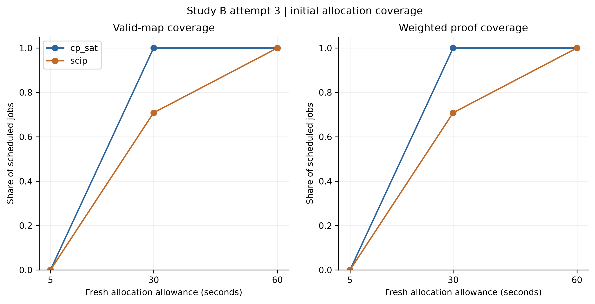
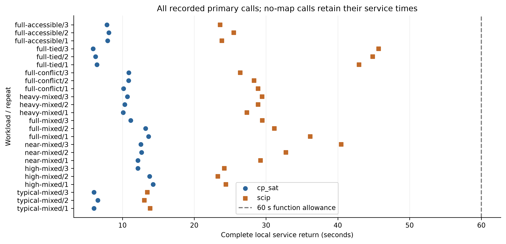
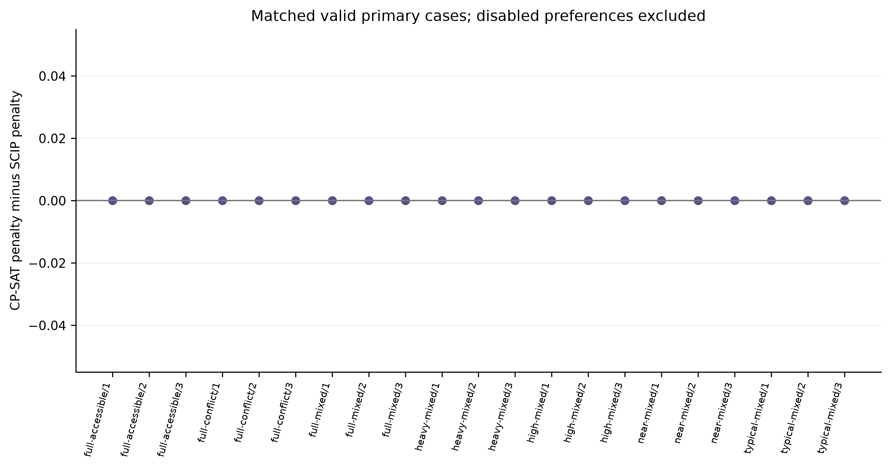

# Study B attempt 3: interpretation of the production initial-allocation benchmark

*23 October 2026. This interpretation uses the completed attempt 3 records. The [generated result summary](results.md), [manifest](manifest.json), [audit](checks.json), [run records](tables/run-records.csv), [coverage table](tables/coverage.csv), [matched objectives](tables/paired-objectives.csv), and [phase timing](tables/phase-timing.csv) are the underlying evidence. See the [Study A and B synthesis](../solver-selection-study-a-study-b-attempt3-synthesis.md) for the relationship to the earlier controlled experiment.*

## Scope and decision rule

Study B tests **initial seating-plan generation** through the local production service path. Its eight frozen event/setting pairs were each run twice with the original input order and once with a semantics-preserving permutation, for both CP-SAT and SCIP at separate 5-, 30-, and 60-second allowances. Both backends were configured with eight workers/native concurrent solvers. The 144 scheduled jobs all completed; the 48 jobs at 60 seconds form the primary comparison. The 5- and 30-second jobs are fresh diagnostic runs, not successive observations of one solver run. The [attempt 3 protocol](../../planning/solver-selection-production-attempt3.md) defines the selection contract; attempt 2's stopped run is not pooled with these results.

The agreed priority is: **valid-map coverage at 60 seconds**, then penalty on matched valid cases, proof coverage, and complete local service-return time. Zero invalid adopted maps is a requirement. A valid map returned without proof would count for coverage as `FEASIBLE`; an `OPTIMAL` label requires proof of the weighted objective minimum. Physical-map identity is not a selection measure because identical-request repeatability can be provided by the application cache; that cache was not tested here. The 60-second allowance is a current engineering setting, not an established staff response-time requirement.

## Primary result: 60 seconds

| Decision measure | CP-SAT, eight workers | SCIP, eight native concurrent solvers | Interpretation |
| --- | ---: | ---: | --- |
| Valid adopted maps | 24/24 | 24/24 | Coverage ties on this cohort. |
| Invalid adopted maps | 0 | 0 | Both satisfy the safety gate. |
| Matched active-preference penalty | Equal in all 21 pairs | Equal in all 21 pairs | Neither has a measured preference-cost advantage. |
| Proven weighted optima | 24/24 | 24/24 | Proof coverage ties; every adopted map is `OPTIMAL`. |
| Complete local service-return time, mean | 9.990 s | 28.645 s | CP-SAT returned sooner in all 24 paired calls. |
| Complete local service-return time, median | 10.515 s | 28.616 s | The observed difference is not confined to one outlier. |
| Complete local service-return time, range | 5.907–14.274 s | 13.061–45.694 s | Every primary call returned inside 60 seconds. |

The 21 active-preference comparisons are seven event/setting pairs with three executions each. The other three pairs use `full-tied/disabled`: their objective is zero by construction, so they establish map availability, proof and timing, but do not add evidence about preference quality. The common weighted objective should only be compared **within the same event and setting**, not averaged across different demand profiles and preference weights. The [matched-objective table](tables/paired-objectives.csv) reports CP-SAT minus SCIP as zero for every active primary pair. Equal proven objective values do not require identical seat-by-seat allocations.

The paired SCIP-minus-CP-SAT complete-return difference averages **18.655 seconds** across the 24 matched executions (range **6.484–39.787 seconds**), and all 24 differences are positive. This measures return of the full local service response, including independent validation, formatting, SQLite persistence and JSON encoding. It excludes interpreter startup, browser and network latency. Weighted-stage return alone averages 8.449 seconds for CP-SAT and 26.511 seconds for SCIP; it is neither the first feasible-map time nor the moment an optimal incumbent was first discovered.

### What the figures show

*Figure B1.* The valid-map and proof curves coincide because every **adopted** map at 30 and 60 seconds was proven. At 5 seconds neither backend has an adopted map; at 30 seconds CP-SAT has 24/24 and SCIP 17/24; at 60 seconds both have 24/24. Lines join independent endpoint summaries and must not be read as continuous progress within a single solve. [PDF](figures/attempt3-coverage-by-allowance.pdf) · [SVG](figures/attempt3-coverage-by-allowance.svg)

*Figure B2.* Each event/setting has three paired runs. Every CP-SAT mark lies to the left of its SCIP counterpart, including the disabled-preference control. The dashed 60-second line is the configured function allowance; the plotted complete service times include downstream work and all happen to finish before that line in the primary cohort. Three executions per case show observed variation, not a population latency guarantee. [PDF](figures/attempt3-complete-service-time.pdf) · [SVG](figures/attempt3-complete-service-time.svg)

*Figure B3.* All 21 active-preference CP-SAT-minus-SCIP penalty differences sit exactly at zero. The disabled-preference control is excluded. This is equality for the declared modeled penalty on these cases; it does not show identical physical maps or independently measured human satisfaction. [PDF](figures/attempt3-matched-penalties.pdf) · [SVG](figures/attempt3-matched-penalties.svg)

### Time by case

The table reports means of the three complete local service returns per backend, rounded to three decimals. It explains where Figure B2's separation occurs; it is not a separate sample.

| Event / setting | CP-SAT mean (s) | SCIP mean (s) |
| --- | ---: | ---: |
| `typical-mixed/current` | 6.220 | 13.464 |
| `high-mixed/current` | 13.401 | 23.969 |
| `near-mixed/current` | 12.454 | 34.161 |
| `full-mixed/current` | 12.668 | 32.273 |
| `heavy-mixed/current` | 10.375 | 28.566 |
| `full-conflict/reversed` | 10.643 | 27.884 |
| `full-tied/disabled` | 6.198 | 44.509 |
| `full-accessible/two` | 7.958 | 24.330 |

The largest observed mean separation is the disabled-preference control, but the direction also holds for every active-preference case and every matched repetition. The [run records](tables/run-records.csv) allow inspection of individual values.

## Diagnostic endpoints and why 5 seconds returns no map

| Fresh allowance | CP-SAT valid / proven | SCIP valid / proven | Outcome detail |
| --- | ---: | ---: | --- |
| 5 s | 0/24 / 0/24 | 0/24 / 0/24 | CP-SAT has 21 `no_map` and three `late_candidate`; SCIP has 24 `no_map`. |
| 30 s | 24/24 / 24/24 | 17/24 / 17/24 | SCIP's other seven are `late_candidate`, not invalid maps or failed jobs. |
| 60 s | 24/24 / 24/24 | 24/24 / 24/24 | Primary result above. |

At 5 seconds, normalization plus model building alone consumed at least five seconds in **14/24 CP-SAT** and **15/24 SCIP** runs, according to [phase timing](tables/phase-timing.csv). Thus the shared function allowance often left no weighted-search time. Three CP-SAT weighted stages returned just after the boundary (about 5.04–5.08 seconds) with complete candidates, but the contract rejected them as late. Zero adopted maps under this clock does **not** establish that either solver is unable to find a map within five seconds of search, and cannot be directly compared with Study A's five-second search allowance.

At 30 seconds, all seven non-adopted SCIP cases produced valid, proven weighted-stage candidates, but their stages returned at **30.066–38.529 seconds**, after the allowance. The correct 30-second coverage is 17/24, not 24/24, because a late candidate cannot be adopted. This is a service-boundary result, not evidence that those seven instances lacked feasible or optimal solutions. CP-SAT adopted and proved all 24 within the 30-second allowance. The 5- and 30-second outcomes are useful sensitivity information but do not override the agreed 60-second decision order.

## Resource observations and limits

Across the 24 primary calls per backend, mean process CPU time was **19.695 s** for CP-SAT and **119.747 s** for SCIP. Mean Windows process-lifetime peak working set was **187.893 MiB** and **995.804 MiB**, respectively. These are descriptive resource measurements from fresh workers, including native solver threads; they are not monetary costs, per-stage memory, or a controlled concurrency-capacity test. The SCIP native logs show eight concurrent solver instances launched in every primary run, which verifies the intended configuration but does not measure sustained CPU use. A separate worker/thread sensitivity sweep would be needed to isolate the effect of parallelism.

The [audit](checks.json) reports **144/144 completed jobs**, **99 independently rescored candidates**, **zero invalid adopted maps**, and **no model defects**. Rescored candidates include late candidates; 99 is not a count of adopted maps. All inputs are known-feasible synthetic scenarios on one recorded Windows environment. Three related executions per case, including an input-order permutation, cannot estimate reliability over real future assemblies. The benchmark does not test infeasible requests, cache behavior, preference-update regeneration, or absence repair. It also does not isolate solver algorithm from model encoding, preprocessing, or implementation overhead.

## Selection implication

Under the agreed hierarchy and the **tested eight-worker, 60-second initial-generation configuration**, CP-SAT and SCIP tie on valid-map coverage, active-preference penalty, proof coverage and the zero-invalid gate. CP-SAT then wins the observed complete local service-return comparison in all 24 matched calls. The evidence therefore supports **retaining CP-SAT as the current initial-generation solver** rather than refactoring that default to SCIP on the basis of Study A alone. This is a conditional engineering choice for the tested service path, not a claim that CP-SAT is universally faster or that all future cases will be proven optimal. Preference-update regeneration and absence repair require their own evaluation after the initial-generation choice.
