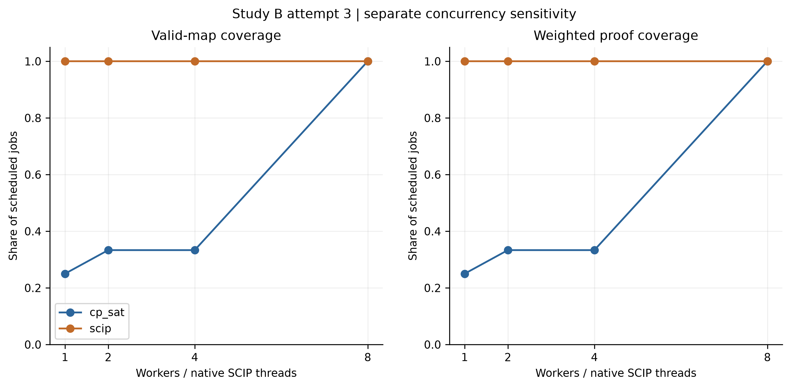

# Study B attempt 3: initial allocation results

Status: **completed**. Mode: **sweep**. Development only: **False**. Audits passed: **True**.

[Manifest](manifest.json) · [Checks](checks.json) · [Run records](tables/run-records.csv) · [Coverage](tables/coverage.csv) · [Matched penalties](tables/paired-objectives.csv) · [Phase timing](tables/phase-timing.csv)

## Coverage

| Batch | Allowance | Workers | Backend | Valid maps | Proven | Scheduled |
| --- | ---: | ---: | --- | ---: | ---: | ---: |
| sweep | 60 s | 1 | cp_sat | 3 | 3 | 12 |
| sweep | 60 s | 1 | scip | 12 | 12 | 12 |
| sweep | 60 s | 2 | cp_sat | 4 | 4 | 12 |
| sweep | 60 s | 2 | scip | 12 | 12 | 12 |
| sweep | 60 s | 4 | cp_sat | 4 | 4 | 12 |
| sweep | 60 s | 4 | scip | 12 | 12 | 12 |
| sweep | 60 s | 8 | cp_sat | 12 | 12 | 12 |
| sweep | 60 s | 8 | scip | 12 | 12 | 12 |

This is a separate 60-second worker/thread sensitivity study. Compare each backend's 1/2/4/8 settings for valid-map and proof coverage, matched valid-case penalty, complete service time, native SCIP launches, process CPU seconds and peak working set. Do not pool these jobs with the main solver-selection denominator.

## Interpretation

Separate worker/thread sensitivity evidence; do not pool with the 60-second initial-selection denominator

The allowance covers normalization, model building and weighted search; independent validation, formatting, SQLite persistence and JSON encoding contribute to complete service return. A stage-return timestamp is not the first incumbent-discovery time. No staff response-time requirement has been established. Three executions per case are descriptive and do not estimate population reliability. Native SCIP launch counts establish concurrent solver instances, not sustained CPU utilization. This benchmark does not exercise a result cache, preference-update regeneration or absence repair.

## Figures

[PDF](figures/attempt3-sweep-coverage.pdf) | [SVG](figures/attempt3-sweep-coverage.svg)
